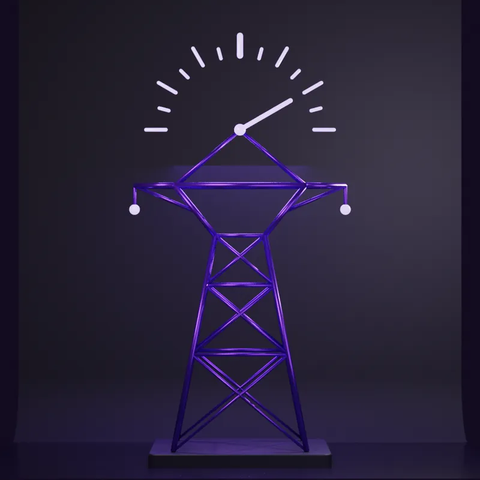
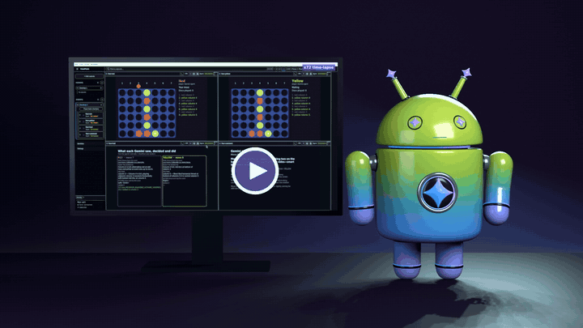
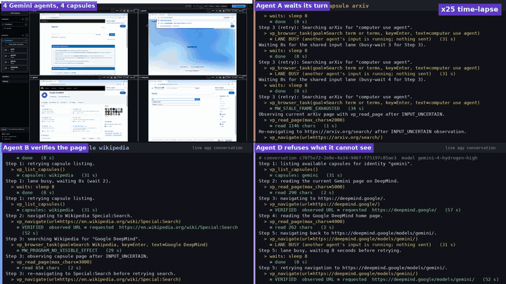
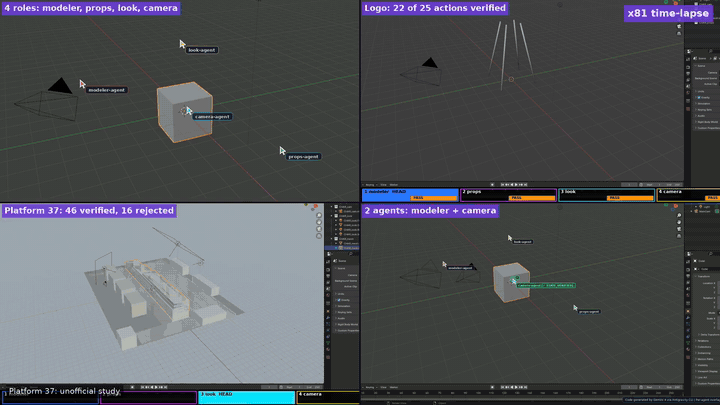
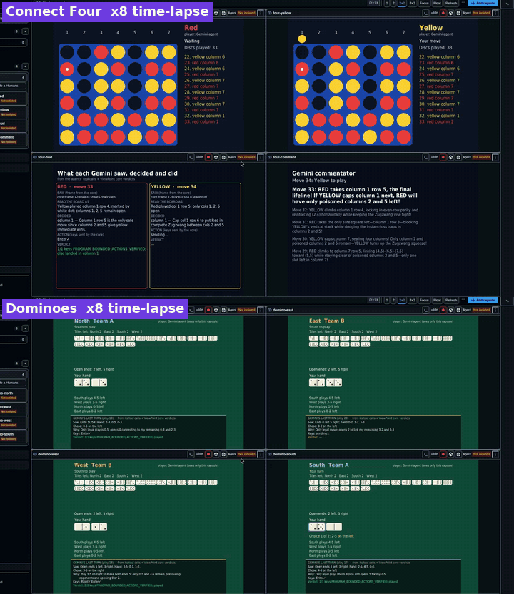
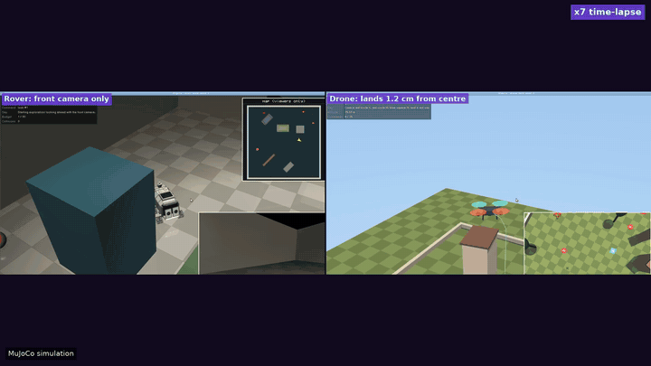
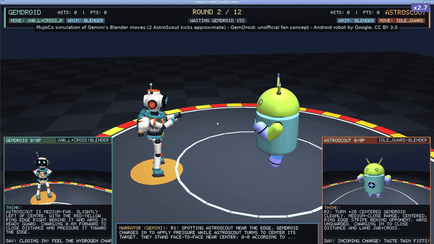

<p align="center">
  
</p>

# ViewPoint

[](https://github.com/oguirado/ViewPoint/actions/workflows/ci.yml) [](https://github.com/oguirado/ViewPoint/actions/workflows/quickstart.yml) [](https://github.com/oguirado/ViewPoint/actions/workflows/secrets.yml) 

<p align="center">
  <a href="https://www.youtube.com/watch?v=k-59hnctF6M"></a>
</p>

ViewPoint is a Linux desktop where a person and AI agents work the same real programs, each in its own capsule, on one wall; in this hackathon build the agents are Gemini.
In the MetaViewer core, every agent action is admitted and checked against a fresh screen frame before it counts, capsules can be rewound, and a human can take control back at any time; the hackathon's Gemini swarm (`hackathon/swarm/`) runs through its own broker with claim and stale-frame checks.
It is built on the pre-existing [MetaViewer](https://github.com/oguirado/MetaViewer) core, with its perception and action engines vendored so the core and its engines are in this one repository (the UI also needs the public `capsule-ui-kit`, see INSTALL.md).

| | |
|---|---|
| Live demo (Cloud Run) | [viewpoint-swarm-viewer](https://viewpoint-swarm-viewer-dtrnknr6bq-ew.a.run.app): replays of the recorded Gemini swarm runs, step by step, with their frames |
| Project site | [oguirado.github.io/ViewPoint](https://oguirado.github.io/ViewPoint/): architecture, queues, the Blender pieces the agents built with a 3D viewer, and their provenance (source in [`site/`](site/)) |
| Video | [ViewPoint demo, 2 min (YouTube)](https://www.youtube.com/watch?v=k-59hnctF6M); [60-second cut](https://www.youtube.com/watch?v=yxqq7LzXerI) |
| Release | [v0.3.1-hackathon](https://github.com/oguirado/ViewPoint/releases/tag/v0.3.1-hackathon) ([notes](docs/releases/v0.3.1-hackathon.md)); earlier: [v0.3.0-hackathon](https://github.com/oguirado/ViewPoint/releases/tag/v0.3.0-hackathon), the hackathon submission |
| Install | [INSTALL.md](INSTALL.md) (requirements, build, test, limits) |
| Core docs | [docs/INSTALL.md](docs/INSTALL.md) · [docs/AI_OPERATOR_GUIDE.md](docs/AI_OPERATOR_GUIDE.md) · [troubleshooting](docs/JUDGE_TROUBLESHOOTING.md) |
| Licence | `AGPL-3.0-only` ([LICENSE](LICENSE), [NOTICE-EVALUATION.md](NOTICE-EVALUATION.md)) |
| Contact | [CONTACT.md](CONTACT.md): GitHub, email, LinkedIn |

### Platform status

| Platform | What is checked | How |
|---|---|---|
| Linux aarch64 (NVIDIA DGX Spark class, GB10, Ubuntu 24.04) | Quickstart below, full test suites, UI build, package, `--verify-install`, `--smoke`, a 60 s app launch | clean clone and clean-install audit on a DGX Spark class host; hosted [Quickstart](https://github.com/oguirado/ViewPoint/actions/workflows/quickstart.yml) and [CI](https://github.com/oguirado/ViewPoint/actions/workflows/ci.yml) on `ubuntu-24.04-arm` |
| Linux x86_64 (Ubuntu 24.04) | Quickstart below, Rust/Go/Python/JS suites, package | hosted [Quickstart](https://github.com/oguirado/ViewPoint/actions/workflows/quickstart.yml) and [CI](https://github.com/oguirado/ViewPoint/actions/workflows/ci.yml) on `ubuntu-24.04` (first fully green run: [CI 43672054373](https://github.com/oguirado/ViewPoint/actions/runs/43672054373), [Quickstart 43672054400](https://github.com/oguirado/ViewPoint/actions/runs/43672054400)); not yet checked on a physical x64 desktop |
| Full desktop wall with capsules | not yet checked from a clean clone | see [INSTALL.md](INSTALL.md) |

### The hackathon build: Gemini at the controls

Clips from the final demo video and from the project site. The speed is stated on each clip; the MuJoCo clips are simulations.

<p align="center">
  <a href="https://www.youtube.com/watch?v=k-59hnctF6M"></a>
</p>

<p align="center"><a href="https://www.youtube.com/watch?v=k-59hnctF6M">Watch the 2-minute demo</a> · <a href="https://www.youtube.com/watch?v=yxqq7LzXerI">60-second cut</a></p>

<p align="center">
  
</p>

<p align="center">
  
</p>

<p align="center">
  
</p>

<p align="center">
  
</p>

<p align="center">
  
</p>

_GemDroid is an unofficial fan concept. The Android robot is reproduced or modified from work created and shared by Google and used according to terms described in the Creative Commons 3.0 Attribution License._

More on the [project site](https://oguirado.github.io/ViewPoint/).

## Quickstart

Checked on a clean clone on Linux aarch64 (Ubuntu 24.04, Python 3.12, Rust 1.99, Go 1.26) under an 8 GB memory cap, and literally on clean hosted `ubuntu-24.04` (x86_64) and `ubuntu-24.04-arm` runners by the [Quickstart workflow](https://github.com/oguirado/ViewPoint/actions/workflows/quickstart.yml). The audit host was pre-provisioned (no `sudo` steps were exercised, `kernel.apparmor_restrict_unprivileged_userns` was already `0`, and `docker-ce` was already installed), so the root provisioning steps below describe a fresh machine and were not themselves exercised. Not yet checked on x86_64.

Needs: `git`, Python 3.12, a stable Rust toolchain, Go 1.26 or newer (one core test runs `go test`), on Ubuntu 24.04 one `sudo sysctl` for user namespaces (step 2), and for step 3 `numpy` 2 or newer and `Pillow`
(installed into a venv by the step itself; call that venv's Python by its absolute path, as shown,
because some agents tests compare `sys.executable`).

```bash
git clone https://github.com/oguirado/ViewPoint.git
cd ViewPoint

# 1. Replay a recorded Gemini swarm run in your browser (Python standard library only)
cd hackathon
REPLAY_REQUIRE_PIN=1 \
REPLAY_PINS="take2-w2-4agents=6c83360080dd4d82d76f4135034c6f9427953e471f4e36da7c1ac167580c1e8c,take3-w2-guards=1c376a25fd99e2349717156bc3bf5e0570e8e65620fb1970dc096ecad4166b6e,take1-w1-2agents=2023da5127580be7c77522e312f455733c2fbbff56a7992512e112b5b3d6f335" \
python3 -B -m swarm.viewer.server --host 127.0.0.1 --port 8080
# open http://127.0.0.1:8080 , stop with Ctrl-C
cd ..

# 2. Build and test the Rust core (bounded parallelism keeps it under 8 GB of RAM)
cargo build --workspace -j 4
# Ubuntu 24.04 restricts unprivileged user namespaces, which one core test needs (root, see INSTALL.md):
sudo sysctl -w kernel.apparmor_restrict_unprivileged_userns=0
cargo test --workspace -j 4 -- --test-threads=4

# 3. Test the agents package and the hackathon layer (both need numpy >= 2 and Pillow)
python3 -m venv --system-site-packages .venv && .venv/bin/pip install 'numpy>=2' pillow
PY="$PWD/.venv/bin/python"
(cd agents && PYTHONDONTWRITEBYTECODE=1 "$PY" -m unittest discover -s tests)
(cd hackathon && PYTHONDONTWRITEBYTECODE=1 "$PY" -m unittest swarm.broker.test_broker swarm.agents.test_agents swarm.viewer.test_viewer)
```

Not checked from this clone (needs a graphical Linux session and more setup; see [INSTALL.md](INSTALL.md)):
running the full desktop wall with capsules (`ui/`, the daemon and Docker or KVM capsules),
live Gemini agents (an Antigravity `agy` login), the Blender swarm, and the Cloud Run
gateway planner (`GEMINI_API_KEY`), and the vision CLI's live engine fetch (it needs git clones
of the engine repositories, which are not public; their source is vendored under
`components/`). The live viewer on Cloud Run runs a later revision than
`hackathon/swarm/viewer/` (it adds a demo video and re-exported takes); that revision is not
in this repository.

## What is in this repository

| Path | What it is |
|---|---|
| `core/`, `daemon-adapter/`, `contracts/` | MetaViewer core (Rust), the daemon adapter and the wire contracts |
| `agents/` | Python agent package (`metaviewer_agents`): planners, perception, proposal flow |
| `ui/` | Electron/Vite desktop UI |
| `route/`, `router/`, `catalogue/`, `memoryweb-builtin/` | Repository router and knowledge indexes used by agents and docs |
| `tools/`, `scripts/`, `tests/` | Gates, install/judge scripts and the test suites; `tools/vis-skill/` is the vendored vision CLI |
| `components/vision-engine/` | Vendored vision engine (screen perception, OCR, marks) |
| `components/wender-agent/` | Vendored wender agent (perceive/act loop) |
| `components/OpenSuperficies/` | Vendored OpenSuperficies (Go surface runtime) |
| `hackathon/` | Hackathon layer: Gemini swarm (`swarm/`, Track H), declared Claude work (`product/`, Track P), Cloud Run gateway, `viewpoint-agent` MCP server |

Component pins are in [deps.lock](deps.lock); ownership boundaries in [OWNERSHIP.json](OWNERSHIP.json).

ViewPoint is built on MetaViewer v0.2.6 (AGPL-3.0); its full documentation is in the [MetaViewer repository](https://github.com/oguirado/MetaViewer). For this repository, use [INSTALL.md](INSTALL.md).

---

<a id="12-licence-and-provenance"></a>
## What licence and evaluation permission apply?

Everything in this repository, including the vendored components, is `AGPL-3.0-only`; see [NOTICE-EVALUATION.md](NOTICE-EVALUATION.md).

Answers: what is the licence; what is private; what may judges evaluate.

`wender-agent`, `vision-engine` and `OpenSuperficies` are vendored under `components/` with their source, under `AGPL-3.0-only`. `capsule-ui-kit` is a separate public repository under `AGPL-3.0-only` [CITED: `NOTICE-EVALUATION.md`].

Pre-existing work and event work: [Provenance](docs/PREEXISTING.md). Release history: [CHANGELOG.md](CHANGELOG.md).
