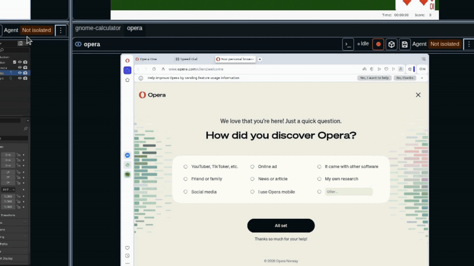
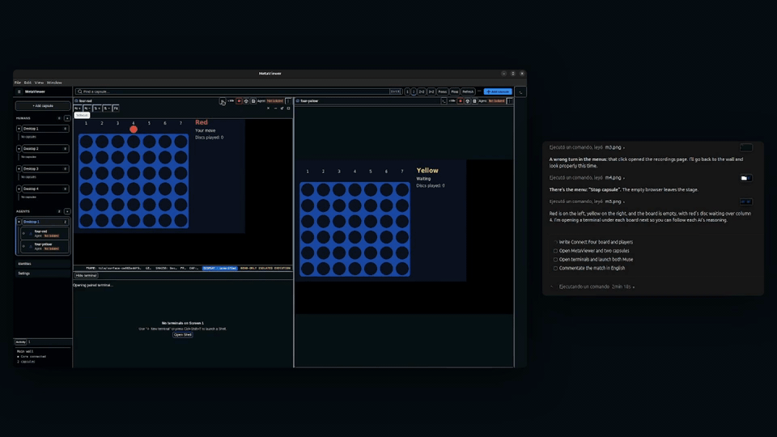
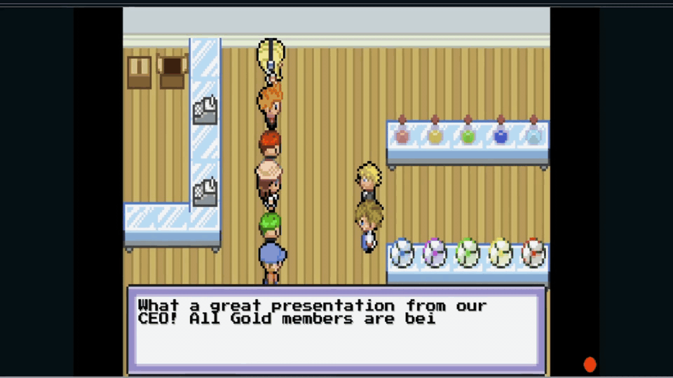
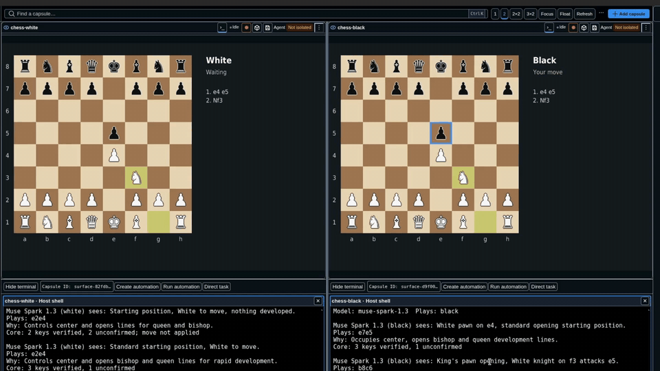
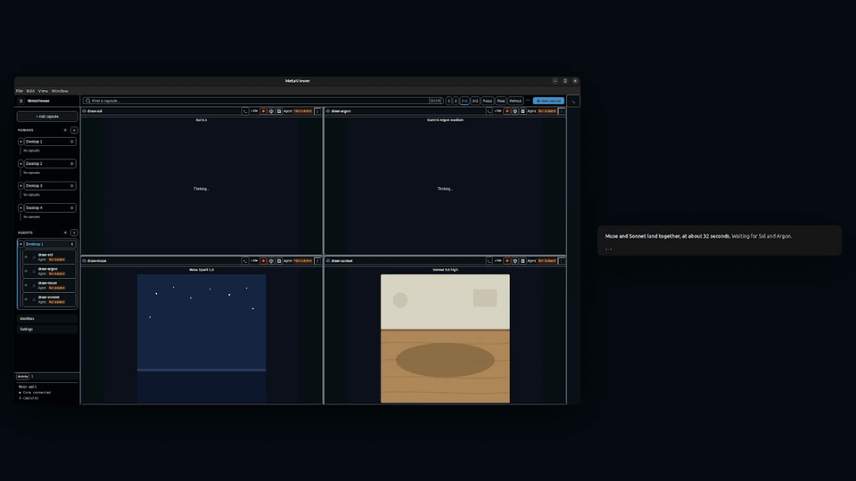
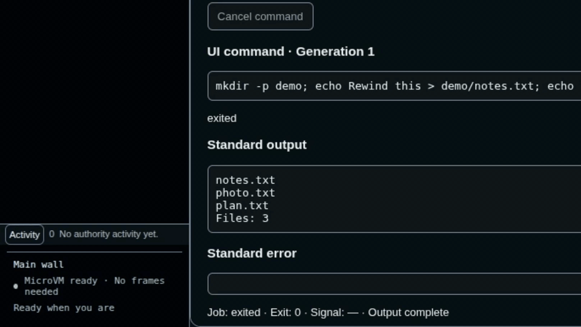

# ViewPoint

[](https://github.com/oguirado/ViewPoint/actions/workflows/ci.yml) [](https://github.com/oguirado/ViewPoint/actions/workflows/quickstart.yml) [](https://github.com/oguirado/ViewPoint/actions/workflows/secrets.yml) 

ViewPoint is a Linux desktop where a person and AI agents work the same real programs, each in its own capsule, on one wall; in this hackathon build the agents are Gemini.
In the MetaViewer core, every agent action is admitted and checked against a fresh screen frame before it counts, capsules can be rewound, and a human can take control back at any time; the hackathon's Gemini swarm (`hackathon/swarm/`) runs through its own broker with claim and stale-frame checks.
It is built on the pre-existing [MetaViewer](https://github.com/oguirado/MetaViewer) core, with its perception and action engines vendored so the core and its engines are in this one repository (the UI also needs the public `capsule-ui-kit`, see INSTALL.md).



_The wall above is a pre-existing MetaViewer recording made before the hackathon (an AI opens six applications); it is not a Gemini run. The Gemini swarm runs are in the replay viewer below and in `hackathon/`._

| | |
|---|---|
| Live demo (Cloud Run) | [viewpoint-swarm-viewer](https://viewpoint-swarm-viewer-dtrnknr6bq-ew.a.run.app): replays of the recorded Gemini swarm runs, step by step, with their frames |
| Project site | [oguirado.github.io/viewpoint-site](https://oguirado.github.io/viewpoint-site/): the Blender pieces the agents built, with a 3D viewer and their provenance |
| Video | _YouTube link — to be added_ |
| Release | [v0.3.0-hackathon](https://github.com/oguirado/ViewPoint/releases/tag/v0.3.0-hackathon) |
| Install | [INSTALL.md](INSTALL.md) (requirements, build, test, limits) |
| Who wrote what | [PROVENANCE.md](PROVENANCE.md): pre-existing core, Gemini (Track H), Claude (Track P and the assembly) |
| Licence | `AGPL-3.0-only` ([LICENSE](LICENSE), [NOTICE-EVALUATION.md](NOTICE-EVALUATION.md)) |

### Platform status

| Platform | What is checked | How |
|---|---|---|
| Linux aarch64 (NVIDIA DGX Spark class, GB10, Ubuntu 24.04) | Quickstart below, full test suites, UI build, package, `--verify-install`, `--smoke`, a 60 s app launch | clean clone and clean-install audit on a DGX Spark class host; hosted [Quickstart](https://github.com/oguirado/ViewPoint/actions/workflows/quickstart.yml) and [CI](https://github.com/oguirado/ViewPoint/actions/workflows/ci.yml) on `ubuntu-24.04-arm` |
| Linux x86_64 (Ubuntu 24.04) | Quickstart below, Rust/Go/Python/JS suites, package | hosted [Quickstart](https://github.com/oguirado/ViewPoint/actions/workflows/quickstart.yml) and [CI](https://github.com/oguirado/ViewPoint/actions/workflows/ci.yml) on `ubuntu-24.04` (first fully green run: [CI 43672054373](https://github.com/oguirado/ViewPoint/actions/runs/43672054373), [Quickstart 43672054400](https://github.com/oguirado/ViewPoint/actions/runs/43672054400)); not yet checked on a physical x64 desktop |
| Full desktop wall with capsules | not yet checked from a clean clone | see [INSTALL.md](INSTALL.md) |

## Quickstart

Checked on a clean clone on Linux aarch64 (Ubuntu 24.04, Python 3.12, Rust 1.99, Go 1.26) under an 8 GB memory cap, and literally on clean hosted `ubuntu-24.04` (x86_64) and `ubuntu-24.04-arm` runners by the [Quickstart workflow](https://github.com/oguirado/ViewPoint/actions/workflows/quickstart.yml). The audit host was pre-provisioned (no `sudo` steps were exercised, `kernel.apparmor_restrict_unprivileged_userns` was already `0`, and `docker-ce` was already installed), so the root provisioning steps below describe a fresh machine and were not themselves exercised. Not yet checked on x86_64.

Needs: `git`, Python 3.12, a stable Rust toolchain, Go 1.26 or newer (one core test runs `go test`), on Ubuntu 24.04 one `sudo sysctl` for user namespaces (step 2), and for step 3 `numpy` 2 or newer and `Pillow`
(installed into a venv by the step itself; call that venv's Python by its absolute path, as shown,
because some agents tests compare `sys.executable`).

```bash
git clone https://github.com/oguirado/ViewPoint.git
cd ViewPoint

# 1. Replay a recorded Gemini swarm run in your browser (Python standard library only)
cd hackathon
REPLAY_REQUIRE_PIN=1 \
REPLAY_PINS="take2-w2-4agents=6c83360080dd4d82d76f4135034c6f9427953e471f4e36da7c1ac167580c1e8c,take3-w2-guards=1c376a25fd99e2349717156bc3bf5e0570e8e65620fb1970dc096ecad4166b6e,take1-w1-2agents=2023da5127580be7c77522e312f455733c2fbbff56a7992512e112b5b3d6f335" \
python3 -B -m swarm.viewer.server --host 127.0.0.1 --port 8080
# open http://127.0.0.1:8080 , stop with Ctrl-C
cd ..

# 2. Build and test the Rust core (bounded parallelism keeps it under 8 GB of RAM)
cargo build --workspace -j 4
# Ubuntu 24.04 restricts unprivileged user namespaces, which one core test needs (root, see INSTALL.md):
sudo sysctl -w kernel.apparmor_restrict_unprivileged_userns=0
cargo test --workspace -j 4 -- --test-threads=4

# 3. Test the agents package and the hackathon layer (both need numpy >= 2 and Pillow)
python3 -m venv --system-site-packages .venv && .venv/bin/pip install 'numpy>=2' pillow
PY="$PWD/.venv/bin/python"
(cd agents && PYTHONDONTWRITEBYTECODE=1 "$PY" -m unittest discover -s tests)
(cd hackathon && PYTHONDONTWRITEBYTECODE=1 "$PY" -m unittest swarm.broker.test_broker swarm.agents.test_agents swarm.viewer.test_viewer)
```

Not checked from this clone (needs a graphical Linux session and more setup; see [INSTALL.md](INSTALL.md)):
running the full desktop wall with capsules (`ui/`, the daemon and Docker or KVM capsules),
live Gemini agents (an Antigravity `agy` login), the Blender swarm, and the Cloud Run
gateway planner (`GEMINI_API_KEY`), and the vision CLI's live engine fetch (it needs git clones
of the engine repositories, which are not public; their source is vendored under
`components/`). The live viewer on Cloud Run runs a later revision than
`hackathon/swarm/viewer/` (it adds a demo video and re-exported takes); that revision is not
in this repository.

## What is in this repository

| Path | What it is |
|---|---|
| `core/`, `daemon-adapter/`, `contracts/` | MetaViewer core (Rust), the daemon adapter and the wire contracts |
| `agents/` | Python agent package (`metaviewer_agents`): planners, perception, proposal flow |
| `ui/` | Electron/Vite desktop UI |
| `route/`, `router/`, `catalogue/`, `memoryweb-builtin/` | Repository router and knowledge indexes used by agents and docs |
| `tools/`, `scripts/`, `tests/` | Gates, install/judge scripts and the test suites; `tools/vis-skill/` is the vendored vision CLI |
| `components/vision-engine/` | Vendored vision engine (screen perception, OCR, marks) |
| `components/wender-agent/` | Vendored wender agent (perceive/act loop) |
| `components/OpenSuperficies/` | Vendored OpenSuperficies (Go surface runtime) |
| `hackathon/` | Hackathon layer: Gemini swarm (`swarm/`, Track H), declared Claude work (`product/`, Track P), Cloud Run gateway, `viewpoint-agent` MCP server |

Component pins are in [deps.lock](deps.lock); ownership boundaries in [OWNERSHIP.json](OWNERSHIP.json).

Everything below this line is the README of the MetaViewer core (v0.2.6), kept as the core's
documentation. Its install route (the packaged x64 judge kit) installs the MetaViewer v0.2.6
release assets from the MetaViewer repository, not this tree; for this repository use
[INSTALL.md](INSTALL.md).

---

# MetaViewer

<a id="metaviewer-a-live-wall-of-capsules-where-a-human-and-an-ai-share-one-desktop-under-one-authority"></a>

MetaViewer is a Linux desktop wall of application capsules that a person and an AI agent can operate under explicit control. It gives agent input a named target, checks the frame the agent saw, and records decisions in a verifiable journal.

Version `0.2.6` [CITED: `VERSION`] · `AGPL-3.0-only` [CITED: `LICENSE`] · [Release](https://github.com/oguirado/MetaViewer/releases/tag/v0.2.6)

**Choose an install:** [x64 packaged kit](#quick-start), with or without Docker capsules; [ARM64 source setup](docs/INSTALL.md#3-building-from-source-and-running-the-gate), with [additional KVM setup for VM and MicroVM](docs/ARM64_CAPSULE_SETUP.md).

**Find an answer:** [judge tour](docs/JUDGE_TOUR.md) · [operate with an AI](docs/AGENT_ENTRY.md) · [capsule design](docs/WHY_CAPSULES.md) · [troubleshooting](docs/JUDGE_TROUBLESHOOTING.md).

<!-- MV:BEGIN mv.node.v1 -->
```json
{
  "schema": "mv.node.v1",
  "version": "0.2.6",
  "repository": "https://github.com/oguirado/MetaViewer",
  "release": "https://github.com/oguirado/MetaViewer/releases/tag/v0.2.6",
  "setup": "bash scripts/judge/metaviewer-judge.sh install",
  "setup_capsules": "bash scripts/judge/metaviewer-judge.sh install --capsules",
  "preflight": "bash scripts/judge/metaviewer-judge.sh doctor --before-install",
  "success_marker": "JUDGE_INSTALL_OK",
  "doctor_marker": "JUDGE_DOCTOR_OK",
  "stop_marker": "JUDGE_STOP_CLEAN",
  "tiers": {
    "T1": "app only; no Docker capsules",
    "T2": "app plus browser and program containers; rootful Docker required",
    "ARM64-dev": "source setup; graphical VM, MicroVM and Rewind need KVM",
    "source": "build with the repository's pinned toolchains"
  },
  "router": "python3 route/route_query.py any \"<question>\"",
  "router_read": "python3 route/route_query.py show \"<reference>\"",
  "router_check": "python3 route/route_query.py check",
  "router_check_marker": "ROUTE_OK",
  "laws_check": "python3 tools/check_laws.py",
  "offline_gate": "bash tools/gate.sh",
  "licence": "AGPL-3.0-only; external components under NOTICE-EVALUATION.md"
}
```
<!-- MV:END mv.node.v1 -->

<a id="0-reading-map"></a>
## See it work

Answers: what does it look like, show me a demo, GIF, video of MetaViewer

Real recordings, sped up, waits cut. An AI drives the app in the first and last; Muse Spark 1.3 chooses the keys in the games through a script loop, and the core checks each one. Results are maintainer-reported; the takes are not published in this repository.


*An AI opens six real applications as capsules, using the mouse and keyboard, and arranges the wall.*



*Two Muse Spark 1.3 players, each with its own capsule and terminal.*



*Muse Spark 1.3 plays Tuxemon. When delivery cannot be confirmed, the core says so and the model looks again.*



*Boards written for the demo, with legal moves given to the players.*



*Four models draw at once by writing SVG. The AI running the contest guesses each drawing before the answers are revealed.*



*Rewind on an ARM64 MicroVM: three files, deleted, restored by Back. Guest memory only; external effects are not rewound.*

## Where should I start?

Install through [Quickstart](#quick-start), or go directly to the guide for your task below.

Answers: where do I start; which document answers my question.

| Task | Read next |
|---|---|
| Evaluate the app as a judge | [Judge tour](docs/JUDGE_TOUR.md), with expected observations |
| Install or build on my platform | [docs/INSTALL.md](docs/INSTALL.md) |
| Let an AI operate a running capsule | [Executable agent entry](docs/AGENT_ENTRY.md) |
| Understand why capsules exist | [Why capsules](docs/WHY_CAPSULES.md) |
| Understand the computer-use workflow | [AI at the controls](docs/AI_AT_THE_CONTROLS.md) |
| Resolve a failure | [Judge troubleshooting](docs/JUDGE_TROUBLESHOOTING.md), then [exact errors](docs/ERRORS.md) |
| Inspect architecture or a message | [Architecture](docs/ARCHITECTURE.md), [reference](docs/REFERENCE.md), `contracts/v0.2/` |
| Find code or change the repository | [Agent protocol](AGENTS.md), then [router commands](route/README.md) |
| Assess evidence and limits | [Evidence](docs/EVIDENCE.md), then [limits below](#isolation-and-evaluation-limits) |

<a id="quick-start"></a>

## MetaViewer judge kit (packaged x64, release v0.2.6)

Use the packaged x64 judge kit after obtaining the release assets and the publisher's manifest digest; use the [source-build instructions](docs/INSTALL.md#3-building-from-source-and-running-the-gate) for ARM64.

Answers: how do I install MetaViewer; what commands do I run; how do I know installation succeeded.

The example selects Docker capsules (tier T2). Obtain the `SHA256SUMS` digest independently from the release publisher and replace the placeholder. If that digest or a required asset is unavailable, stop; do not substitute a digest computed from the downloaded manifest. The fetcher verifies the manifest and selected assets [CITED: `scripts/judge/fetch_assets.py`, `docs/JUDGE_QUICKSTART.md`].

```bash
git clone --branch v0.2.6 --depth 1 https://github.com/oguirado/MetaViewer.git
cd MetaViewer
export RELEASE_ASSET_URL=https://github.com/oguirado/MetaViewer/releases/download/v0.2.6
SHA256SUMS_DIGEST='<publisher-provided SHA256SUMS digest>'
python3 scripts/judge/fetch_assets.py --source "$RELEASE_ASSET_URL" --arch x64 --capsules --sums-sha256 "$SHA256SUMS_DIGEST"
bash scripts/judge/metaviewer-judge.sh doctor --before-install --capsules   # JUDGE_DOCTOR_OK
bash scripts/judge/metaviewer-judge.sh install --capsules                   # JUDGE_INSTALL_OK
bash scripts/judge/metaviewer-judge.sh doctor --capsules                    # JUDGE_DOCTOR_OK
bash scripts/judge/metaviewer-judge.sh run
bash scripts/judge/metaviewer-judge.sh stop                                 # JUDGE_STOP_CLEAN
```

For the app without Docker capsules (tier T1), remove `--capsules` from fetch, doctor and install. Keep the tier consistent throughout. A graphical Linux session is required; full prerequisites and the Windows WSL route are in [docs/INSTALL.md](docs/INSTALL.md).

An operational failure in the judge script prints `CODE: problem -- fix: remedy` and exits `2` [CITED: `scripts/judge/metaviewer-judge.sh:48`]; a usage error exits `64` [CITED: `scripts/judge/metaviewer-judge.sh:55`]. Follow the remedy before continuing. After installation, use the [Judge tour](docs/JUDGE_TOUR.md); for a refusal, use [Judge troubleshooting](docs/JUDGE_TROUBLESHOOTING.md).

<a id="1-abstract-and-result-contract"></a>
<a id="3-how-it-works"></a>
## Why capsules?

A capsule gives each task an addressable application surface with its own control state, so an agent can name what it intends to operate [CITED: `core/src/admission/mod.rs:96`, `core/src/admission/mod.rs:1297`]. Browser and Program capsules use container boundaries, while Host program and Desktop window expose host applications without isolation [CITED: `daemon-adapter/internal/capsule/manager.go`, `ui/src/surfaces/RoleSurface.vue`]. This separates the choice of execution boundary from the human-or-agent control protocol; the tradeoffs and alternatives are in [Why capsules](docs/WHY_CAPSULES.md).

Answers: why does MetaViewer use capsules; what does a capsule provide.

<a id="2-definitions-and-gates"></a>
### What do surface, frame and journal mean?

A **surface** is the target tracked by the core; a **frame** is an observed image with a generation and digest; the **journal** records core events for verification.

Answers: what is a surface; what is a frame generation; what does the journal record.

The Electron wall presents surfaces, the Rust core decides whether input may proceed, and the Go adapter runs capsules and exchanges frames and input. An agent proposal includes `surface_id` and `based_on_frame`; the core checks ownership, liveness, generation and digest before dispatch [CITED: `core/src/admission/mod.rs:1297`]. `mv-replay` checks the saved journal and frame witnesses; it is a verifier, not a command to repeat application actions [CITED: `core/src/bin/mv-replay.rs`]. Process and wire details: [Architecture](docs/ARCHITECTURE.md) and [Reference](docs/REFERENCE.md).

<a id="6-agent-operating-protocol"></a>
## Why computer use with an AI at the controls?

The maintainer recommends an AI at the controls because MetaViewer routes its proposals through frame and ownership checks, giving the agent feedback about whether an action may proceed [CITED: `core/src/admission/mod.rs:1297`]. A person can take control of a live surface, cancelling pending agent work; agent work requires explicit release of control and a fresh frame before it resumes [CITED: `core/src/admission/mod.rs:1136`, `core/src/admission/mod.rs:1159`]. The intended workflow is observe, propose, inspect the result, and hand back to the person when needed; [AI at the controls](docs/AI_AT_THE_CONTROLS.md) explains it and [Agent entry](docs/AGENT_ENTRY.md) provides the executable recipes.

Answers: why is MetaViewer focused on computer use; should I put an AI at the controls.

### How does an AI operate a running capsule?

Use the running app's attachment and copied capsule identity, then follow [docs/AGENT_ENTRY.md](docs/AGENT_ENTRY.md) for the selected task.

Answers: how does an AI attach; what is Direct task; how do I drive a capsule.

1. Open a capsule and its paired terminal. Choose an installed agent CLI or a shell.
2. Use **Copy ID for AI** and **Direct task**. Complete the task text, review it, and submit it yourself. The app prepares text without pressing Enter [CITED: `ui/src/terminal/workflowPrompts.js`, `ui/src/terminal/terminalDeckModel.js:1751`].
3. Follow the attachment and observation recipe in [Agent entry](docs/AGENT_ENTRY.md). Confirm the live capsule identity and control state; do not guess missing values.
4. Execute a supported, bounded step, inspect its verdict and observe the resulting state. Stop on a refusal. After `INPUT_UNCERTAIN`, inspect before considering any further input [CITED: `agents/metaviewer_agents/mw_refusals.py`].
5. At a login or challenge, hand control to the person. Acknowledge only hides the notice; it does not resume the run [CITED: `ui/src/handoff/handoffModel.js`].

Browser and program tasks, authored workflows, and ARM64 MicroVM commands have different recipes. The limits of `mw_run` are specific to that runner and mode; they are not a list of every action supported by the core [CITED: `agents/metaviewer_agents/mw_run.py:339`]. See [docs/AI_OPERATOR_GUIDE.md](docs/AI_OPERATOR_GUIDE.md) for the full workflow.

### How do I submit a reviewed proposal from the CLI?

Use `mvctl propose` with a reviewed proposal file and the registered values from the running app.

Answers: how do I send an action proposal; which CLI submits a proposal.

This command can dispatch input to the authorized capsule. `FILE` is the action-proposal JSON you reviewed; the variables must come from the app attachment. The transport bounds are explicit limits [TARGET], and argument validation is defined in the CLI [CITED: `agents/metaviewer_agents/mvctl.py`].

```bash
PYTHONPATH=agents python3 -m metaviewer_agents.mvctl propose --json-arg FILE \
  --socket "$MV_CORE_SOCKET" --session-id "$MV_SESSION_ID" \
  --agent-instance "$MV_AGENT_INSTANCE" --core-instance "$MV_CORE_INSTANCE" \
  --timeout-ms 5000 --max-line-bytes 65536 --max-reply-bytes 65536
# Inspect the returned verdict and verify the resulting capsule state.
```

<a id="status"></a>
<a id="5-coverage-and-domain-contracts"></a>
## Which capsule should I choose?

Choose Browser or Program for a container boundary, a host route for an existing application, or the ARM64 developer setup for a guest.

Answers: which capsule kinds exist; which are isolated; what runs on x64 or ARM64.

| Kind | Execution boundary | Platform and setup |
|---|---|---|
| Browser (`identity-browser`) | Container per identity | Docker capsule tier; [install](docs/INSTALL.md) |
| Program (`program`) | Container | Docker capsule tier; [install](docs/INSTALL.md) |
| Host program (`host-program`) | **Not isolated**; runs on the host | Host application and Xpra; [operator guide](docs/AI_OPERATOR_GUIDE.md) |
| Desktop window (`desktop-window`) | **Not isolated**; attaches a host window | X11 window; [operator guide](docs/AI_OPERATOR_GUIDE.md) |
| Graphical VM | Guest | ARM64 with KVM; [setup](docs/ARM64_CAPSULE_SETUP.md) |
| MicroVM and Rewind | Guest; Rewind restores guest RAM | ARM64 with KVM; [setup and limits](docs/ARM64_MICROVM_REWIND.md) |

The host routes and container routes are distinguished in the adapter and launcher [CITED: `daemon-adapter/internal/capsule/manager.go`, `ui/src/catalog/catalogModel.js`]. The guest capability check disables VM and MicroVM on non-ARM64 hosts [CITED: `ui/electron/guestCommandProfile.js:47`]. Rewind does not undo external network effects, host files or the journal; inspect the [Rewind contract](docs/ARM64_MICROVM_REWIND.md).

<a id="4-engineering-triptych"></a>
<a id="7-measured-results"></a>
## What evidence can I check?

Public code and tests support interface and refusal claims; live demonstrations remain maintainer-reported unless their receipts are published.

Answers: what is verified; where is the evidence; what does replay prove.

| Claim | Inspect | Limit |
|---|---|---|
| Stale frames and invalid ownership are refused | `core/src/admission/mod.rs`, `core/tests/admission_matrix.rs` | A refusal test does not certify every application workflow |
| Take control cancels pending agent work | `core/src/admission/mod.rs`, `core/src/journal/mod.rs` | Inspect the pending and already-dispatched cases separately |
| Journal and witnesses can be checked | `core/src/bin/mv-replay.rs`, `core/tests/t1_journal_verify.rs` | Verification does not prove a task was useful or correct |
| Wire messages match their schemas | `contracts/v0.2/`, `python3 tools/check_contracts.py` | Shape validation is not live execution |
| Installation checks have explicit markers | `scripts/judge/metaviewer-judge.sh` | A source test is not an installation on your machine |

`mv-replay` exits `0` on successful verification, `2` for invalid or corrupt input, `3` for a duplicate and `4` for a witness error [CITED: `core/src/bin/mv-replay.rs:41`]. Use the original session's journal and witnesses according to [Evidence](docs/EVIDENCE.md).

<a id="historical-live-evidence"></a>
<a id="live-on-the-026-candidate-measured-live-by-the-maintainer"></a>
### Where are the live demonstrations and receipts?

[AI at the controls](docs/AI_AT_THE_CONTROLS.md) records the maintainer's game and ARM64 Rewind reports; [Evidence](docs/EVIDENCE.md) distinguishes those reports from public test evidence.

Answers: has an AI driven MetaViewer; are the live results independently reproducible.

The reports are not measurements reproduced by this documentation review. Public raw receipts and a published location for the referenced game and Rewind recordings are `ABSENT — do not invent`. Live frame rate and latency at the current pins are also `ABSENT — do not invent`; older observations do not establish current performance.

<a id="isolation-and-evaluation-limits"></a>
<a id="8-rejected-levers-and-negative-results"></a>
<a id="9-limitations"></a>
<a id="11-pending-measurements"></a>
## What are the limits and known problems?

Host routes are not isolated, guest features require ARM64 setup, and a passing offline test suite does not establish live application acceptance.

Answers: what is unsupported; what remains unverified; where are known bugs.

- VM and MicroVM are unavailable on non-ARM64 hosts [CITED: `ui/electron/guestCommandProfile.js:47`]; Rewind profiles also require ARM64 [CITED: `ui/electron/guestCommandProfile.js:11`].
- A stale frame or missing ownership blocks admission [CITED: `core/src/admission/mod.rs:1297`]. After a runner reports `INPUT_UNCERTAIN`, inspect the resulting state before further input [CITED: `agents/metaviewer_agents/mw_refusals.py`]. A successful proposal is not proof of task completion.
- Known maintainer-reported issues, including package bytecode inventory and a terminal exit after a long line, are tracked in [Debug](docs/DEBUG.md) and [Judge troubleshooting](docs/JUDGE_TROUBLESHOOTING.md). Their causes must not be inferred from the symptoms.
- Screenshot and walkthrough publication for this entry page remains pending. Independent live receipts and current performance measurements remain absent.

<a id="10-reproducibility"></a>
## How do I find code or contribute?

Ask the local router, read the cited source, and follow [AGENTS.md](AGENTS.md) and [LAWS.md](LAWS.md) before editing.

Answers: how do I find an implementation; how do I verify a change; how do I build from source.

```bash
python3 route/route_query.py any "<question>"
python3 route/route_query.py show "<reference returned above>"
python3 route/route_query.py check
```

A finding tells you where to look. Only the code proves it. An empty result means retrieval found no answer, not that the feature is absent. Use [router commands](route/README.md) for exact symbols, error text and tests.

The build instructions and pinned toolchains are in [docs/INSTALL.md](docs/INSTALL.md); check coverage is in [Testing](docs/TESTING.md). Run the checks appropriate to your change:

```bash
python3 tools/check_laws.py
python3 tools/check_laws.py --version
python3 tools/check_contracts.py
python3 -B -m unittest discover -s tests -p 'test_*doc*'
bash tools/gate.sh
```

`check_laws.py` validates commit metadata and applicable changelog requirements; it does not scan all prose for privacy or factual accuracy [CITED: `tools/check_laws.py`]. After document changes, the index owner regenerates the docs index and checks `ROUTE_OK`. Contributor catalogue checks are separate; see [AGENTS.md](AGENTS.md).

<a id="12-licence-and-provenance"></a>
## What licence and evaluation permission apply?

Everything in this repository, including the vendored components, is `AGPL-3.0-only`; see [NOTICE-EVALUATION.md](NOTICE-EVALUATION.md).

Answers: what is the licence; what is private; what may judges evaluate.

`wender-agent`, `vision-engine` and `OpenSuperficies` are vendored under `components/` with their source, under `AGPL-3.0-only`. `capsule-ui-kit` is a separate public repository under `AGPL-3.0-only` [CITED: `NOTICE-EVALUATION.md`].

Pre-existing work and event work: [Provenance](docs/PREEXISTING.md). Release history: [CHANGELOG.md](CHANGELOG.md).
