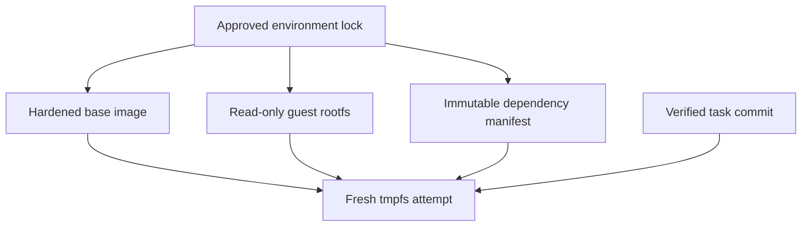

# C1 Capsule lifecycle under Amendment A4

## Status, evidence boundary and precedence

**Design and executable contract fixtures; runtime qualification remains outstanding.** This document specifies the host-owned lifecycle of an attempt using the single hardened base image, an offline tmpfs checkout and a verified text extraction. It does not build an image, launch a capsule, qualify a VMM, change the worker schema or authorize production acceptance.

**[CITED] Bound source:** `oguirado/OpenSuperficies`, requested ref `bridge/integration`, observed commit `c8cb7dc8c0946be08edcb2a419629b6debd33c96`. Every repository `path:line` locator below refers to those exact bytes. Imported research and packs are cited as repository data; their embedded host paths and external citations were not independently inspected. Precedence is the task instruction, then the A4 security baseline, then the worker-bank v3 design and unchanged worker schema, then the remaining inputs (`docs/design/w8d/README.md:3-13`).

**Number convention:** quantities, bounds, exit values and example constants are tagged **[CITED]** when inherited, **[TARGET]** when specified here, or **[MEASURED]** only for observations actually recorded. All numeric literals in normative pseudocode, formulas and inline test fixtures are **[TARGET]** unless explicitly identified as inherited. Protocol names, digest strings, source-line locators, test names and task/question identifiers are identifiers, not measurements. There are no W8 host measurements in this document. The bank itself calls guide measurements targets for W8 (`docs/design/W8_WORKER_BANK.md:10`), and the agent guidance forbids treating VM performance as host evidence (`AGENTS.md:11`).

**[CITED] Security floor:** A4 requires a per-task tmpfs workspace, a rare approved base build, no per-commit images, host inference, no credential/configuration imports, no host binds, rootless hardening, default-deny egress and text-only tar-over-exec extraction (`docs/design/w8d/W8_AMENDMENTS.md:22-27`). The bank already describes a non-inferential Go gate runner and a host Go control plane; its Python fixtures are not a runtime (`docs/design/W8_WORKER_BANK.md:30-34`). This lane therefore specifies Go implementation interfaces and no new VMM. Rust requires separately measured hot-path evidence.

### Conflicting premises resolved

| Bound premise | Decision under A4 |
|---|---|
| The original A1 recipe emits an image on every integration move (`docs/design/w8d/W8_AMENDMENTS.md:2-6`). | **[TARGET]** Advancing the task commit changes only the tmpfs checkout. No image output, tag, image-retention entry or rebuild trigger is created for that commit. |
| A pack describes an unspecified approval-file path and a writable persistent task cache (`docs/design/w8d/packs/D1.md:13`, `docs/design/w8d/packs/D1.md:53`). | **[CITED]** The higher-precedence bank names `/etc/opensuperficies/builder_approval.json`, mode `per_build`, and a task-read-only cache with a separate warm writer (`docs/design/W8_WORKER_BANK.md:96-104`, `docs/design/W8_WORKER_BANK.md:119-121`). |
| A pack uses a host `/dev/shm/os-worker/...` workspace (`docs/design/w8d/packs/D1.md:15`). | **[CITED]** The workspace is capsule `/workspace` tmpfs; no host path is mounted. Frames remain capsule/guest `/dev/shm` only (`docs/design/W8_WORKER_BANK.md:158-159`, `docs/design/W8_WORKER_BANK.md:229`). |
| The existing desktop entrypoint assumes a fixed framebuffer bind and hardcodes `/run/vqa/fb`; it can enable xpra over a generic endpoint (`docker/cu/entrypoint-cu.sh:12`, `docker/cu/entrypoint-cu.sh:58-60`, `docker/cu/entrypoint-cu.sh:91-94`). | **[TARGET]** An immutable worker startup profile replaces those assumptions at implementation time. This design does not claim that the existing entrypoint is an A4-compliant launcher. |
| The existing exec wrapper accepts arbitrary argv and maps only raw exit **[CITED] 1** to **[CITED] 5** (`docker/cu/exec-umask.sh:6-11`). | **[TARGET]** Use the closed Go dispatcher described below and retain raw status separately. The wrapper alone is not an authorization boundary. |
| External-agent guidance suggests `web/<tool>/<task-id>` (`AGENTS.md:8`). | The explicit task authorizes `bridge/os-w8d-c1-capsule-lifecycle/a1` and its exclusive paths; that instruction governs this change. |

## Existing wire compatibility

**[CITED]** Existing objects are closed; cross-document identity, byte-budget and isolation validation belongs to a trusted host verifier (`contracts/worker/os.cu.worker-task.v1.schema.json:5`, `docs/design/W8_WORKER_BANK.md:151-169`). C1 introduces separate, closed sidecar records. It does not add properties to the existing task, grant, runtime, exec, scheduler lease, speech act or extract record.

| Existing location | C1 binding, with inherited fields preserved |
|---|---|
| `runtime.base_image` | Exact existing `{name,digest,recipe_sha256,approval_sha256}`. Name remains `os-worker-base`; C1 `pins.base_image`, `pins.base_recipe`, `pins.base_approval` project those digest values (`contracts/worker/os.cu.worker-task.v1.schema.json:3157-3179`). |
| `runtime.commit`, `runtime.workspace` | Verified commit, tmpfs checkout and fixed read-only cache. `pins.cache_manifest` equals `workspace.cache.manifest_sha256` (`contracts/worker/os.cu.worker-task.v1.schema.json:626-715`, `contracts/worker/os.cu.worker-task.v1.schema.json:3181-3238`). |
| `runtime.vmm` | Keep `name`, `version`, `kernel_sha256`; the richer binary/channel/qualification lock is an external C1 record. Do not add a rootfs property here (`contracts/worker/os.cu.worker-task.v1.schema.json:581-602`). |
| `runtime.nesting` | `outer_image_sha256` equals the base digest. Rootfs belongs in `nesting.rootfs_sha256`; the control channel is `vsock_uds` or `serial` (`contracts/worker/os.cu.worker-task.v1.schema.json:2419-2460`, `docs/design/W8_WORKER_BANK.md:167`). |
| `capsule_exec` | Retain exactly `schema`, `lease_id`, `verb`, `user`, `tini`. Typed C1 operation bodies travel separately on stdin (`contracts/worker/os.cu.worker-task.v1.schema.json:3806-3838`). |
| `receipt.extract` | Retain exactly `method`, `entries`, `bytes`, `text_only`, `mode`, `owner_asserted`, `staging_residue`, `sha256`. The digest covers the exact accepted archive, including its manifest; the manifest does not recursively hash itself (`contracts/worker/os.cu.worker-task.v1.schema.json:3488-3530`). |
| `scheduler_lease` | Preserve its existing state enum. C1 purge progress, fencing epochs and release identities are separate host ownership records (`contracts/worker/os.cu.worker-task.v1.schema.json:2896-2993`). |
| `speech_act` / bridge result | Preserve complete payload fields and real backend surface. C1 does not authorize a guest bus client or modify the codec (`docs/design/W8_WORKER_BANK.md:175-185`). |

**[TARGET] Canonical sidecars:** UTF-8, sorted object keys, compact separators, no trailing newline and integer JSON numbers only; reject duplicate keys, unknown properties, noncanonical encodings and type-confused booleans used as integers. This adopts the existing canonicalization rule **[CITED]** (`contracts/worker/os.cu.worker-task.v1.schema.json:5`). Byte hashes use exact payload bytes, with no Unicode or line-ending normalization. Hex digests use the schema's **[CITED] 64** lowercase characters and repository commits **[CITED] 40** lowercase characters (`contracts/worker/os.cu.worker-task.v1.schema.json:21-31`).

## Environment graph and reproducibility

The graph below is a **[TARGET]** dependency graph, not a build performed by this task.

### Inputs and output identities

**[TARGET]** A locked recipe graph contains the recipe digest, builder-policy digest, target architecture, toolchain/package content pins, fixed fetch identities, exporter policy and explicit output roles. Its permitted reusable image output is the base image; the guest rootfs is a read-only companion from the same environment recipe. Cache objects and a generated Jules setup projection share the same toolchain/dependency lock. Jules parity requires equal declared inputs and gates; it is not inferred from sharing a filename.

**[TARGET]** The environment's source revision is the revision of its reviewed recipe, not the task repository commit. Neither base nor guest rootfs contains task repository code. A bridge move cannot alter the environment output graph. A dependency change that misses the admitted cache ends the attempt; it may motivate a separate operator review of the warm job or environment recipe, never an automatic image build. The bank explicitly removes per-commit image outputs and preserves the shared recipe plus per-repo cache manifest (**[CITED]** `docs/design/W8_WORKER_BANK.md:90-104`, `docs/design/W8_WORKER_BANK.md:314`).

**[TARGET] Recipe graph record:**

The executable sidecar is `os.cu.c1-recipe/v1`, with exact top-level fields `schema`, `base_recipe`, `approval`, `outputs`, `pins`, `builds`, `context`, `input_manifest_sha256`, `build_policy_sha256`. `input_manifest_sha256` hashes canonical `{base_recipe,build_policy_sha256,pins,context}`. Each independent build echoes that input digest in `inputs_sha256`, and its recipe and actual output digests must match the approved graph. The builder policy commits the deterministic acquisition/export settings; changing a declared toolchain or input without updating its input commitment fails.

| Group | Required meaning |
|---|---|
| Recipe/input identity | Recipe digest; builder-policy digest; architecture; deterministic locale/time/export policy; complete declared input set; no ambient environment or host dependency. |
| Package object | Stable object identity, immutable version, actual content digest, exact byte length, relative context source, allowed consumer and executable classification. A version label without verified bytes is insufficient. |
| Output identity | Digest of actual base OCI payload and actual guest-rootfs bytes; same recipe lineage; no task commit, per-commit tag or repository code in either output. |
| Approval | Host-authenticated per-build approval record and its digest; approved recipe digest; invocation identity. Capsules cannot inspect or mutate the approval file. |
| Independent rebuild | Distinct build identities and clean workspaces; equal declared input/policy identities; uncached execution; each builder independently measures actual base and rootfs output bytes. |
| Leak evidence | Host-controlled context enumeration, symlink-resolution checks, declared mount/input graph, output-layer/rootfs scan and probe results. A recipe-authored claim is not trusted evidence. |

**[TARGET] Independence rule:** require **[CITED] 2** uncached builds as specified by the bank (`docs/design/W8_WORKER_BANK.md:103`). Different invocation IDs without independent clean environments do not qualify. Compare actual output digests and deterministic export parameters; keep variable build timestamps and provenance as separate records bound to output digests. Equality of an input-derived key is not output reproducibility. The research expressly separates hermeticity, reproducibility and runtime content verification (**[CITED]** `docs/design/w8d/research/R2.md:1-3`, `docs/design/w8d/research/R2.md:32-33`, `docs/design/w8d/research/R2.md:86`).

**[TARGET] Leak negatives:** refuse `.config`, `.ssh`, home expansion, credentialed URLs, environment inheritance, secret/SSH build mounts, `operator.token`, `launch.token`, key/auth files, absolute context sources, parent traversal, symlinks escaping the approved context, undeclared input objects, frame bytes and task repository code. A digest mismatch on a fetched object fails before build admission. The named path negatives and containment outcome are inherited (**[CITED]** `docs/design/W8_WORKER_BANK.md:102`); inspecting the effective input/mount graph instead of only Dockerfile text follows the bound research (**[CITED]** `docs/design/w8d/research/R2.md:44-63`). Reproducibility and leak admission are independent gates: identical contaminated outputs still fail.

**[TARGET] Approval behavior:** missing installed base/qualification is unavailable; a proposed build whose recipe is outside the operator approval record is `operator_recipe`. No task exec verb invokes a builder or warm writer. The higher-precedence bank fixes per-build approval and prohibits an agent build route (**[CITED]** `docs/design/W8_WORKER_BANK.md:96-104`). Actual approved recipe, image and rootfs digests are deployment inputs, not values invented by this design.

## Fresh workspace and read-only dependency cache

**[TARGET] Ingestion sequence:** the host resolves and verifies an eligible integration commit once, records it in the grant and ownership record, and streams a bounded Git bundle through `ingest`. The capsule receives no URL or authentication material. The immutable ingest program writes the bundle only to `/workspace`, verifies its declared digest/length, clones detached, and verifies HEAD against the grant. Reject hooks, filters, credential helpers, alternates, nested Git repositories, submodules, LFS expansion and inherited Git configuration. Never infer eligibility merely from an untrusted branch name. The bank requires operator-merged reachability, offline bundle ingestion, disabled Git extension paths and exact HEAD (**[CITED]** `docs/design/W8_WORKER_BANK.md:108-115`, `docs/design/W8_WORKER_BANK.md:169`).

**[TARGET]** Use a fresh capsule `/workspace` tmpfs for every attempt, including retries. Redirect HOME, temporary work, build caches and output staging to private tmpfs; the read-only base remains unchanged. Disable disk-backed daemon logging and core dumps. Frame-capable paths and VMM memory backing are governed by the stricter `/dev/shm` rules below. Workspace capacity is part of memory admission, not additional available RAM (**[CITED]** `docs/design/W8_WORKER_BANK.md:63-78`, `docs/design/W8_WORKER_BANK.md:147`).

**[TARGET] Cache authority:** mount only the fixed named volume `os_worker_cache` at `/opt/cache`, task-read-only. Inspect daemon-side volume provenance and driver options: a named volume implemented with a host `device` plus bind options is a forbidden bind. A task cannot supply a volume name, source path, driver option, prompt-memory path or writable cache setting. This is a necessary strengthening of the bank's zero-bind/read-only-cache rules (**[CITED]** `docs/design/W8_WORKER_BANK.md:66`, `docs/design/W8_WORKER_BANK.md:119-121`).

**[TARGET] Cache manifest:** bind schema/version, recipe and toolchain-lock digests, architecture, immutable generation, approved warm-job provenance and an exact object roster. Each object carries its ID, dependency identity, content digest, length and allowed consumer. Selected objects are rehashed on read; the runtime pins the complete manifest. The host warm writer uses a quiescence barrier: it cannot mutate a generation while admitted tasks pin it. Readers retain a generation pin until their cleanup certificate is committed. Mutable compiler outputs stay in task tmpfs. Prompt-memory units, credentials, task Git trees and runtime output are not cache-object kinds.

**[TARGET] Reference projection:** `cache_admit` checks the fixed volume/mount and hashes its canonical `objects` roster. A roster entry is exactly `{object_id,kind,sha256,bytes,repo_commit,base_image,toolchain_lock}`; `repo_commit` binds its declared task use and does not trigger an image. The host adapter compares this digest and context to the admitted runtime/cache pins and retains the producer's schema/generation/warm-job metadata separately. Checking a self-declared roster does not authenticate its producer. The producer record and quiescence barrier remain implementation gates.

**[TARGET] Offline failure:** a missing or corrupt required cache object ends setup; it does not start downloads, build an image, borrow a host cache or relax egress. Distinguish a genuine cache miss, unavailable prerequisite, from an observed digest/content violation, verification failure. The cache-miss/no-egress behavior is inherited (**[CITED]** `docs/design/W8_WORKER_BANK.md:121`). Host memory may later consume an accepted extracted-text reference; no memory path participates in launch rendering or cache selection.

## Closed exec and typed control

**[CITED]** The only outer verbs are `ingest`, `gate`, `status`, `extract`, `purge`; the existing envelope fixes user `10001:10001` and tini (`contracts/worker/os.cu.worker-task.v1.schema.json:3806-3838`). The bank uses argv vectors with the immutable `/opt/w8/<verb>` runner and no general shell (`docs/design/W8_WORKER_BANK.md:205`).

**[TARGET]** `exec_admit(envelope, operation, authority)` validates the existing envelope separately from the C1 body. The body has exactly `op`, `target_id`, `epoch`, `object_id`, `byte_limit`, `payload`. The host authority fixes lease/target/epoch, object-to-operation permissions, byte ceiling, UI grant and absolute expiry. No operation takes an executable path, socket path, URL, environment, mount, arbitrary argv or caller-chosen device. Unknown keys fail before any exec is rendered. Identifiers are looked up in an authenticated host-side table; their spelling is never concatenated into a command or filesystem path.

| Outer verb | C1 operation | Allowed data and destination |
|---|---|---|
| `ingest` | `repo_bundle` | Exact task commit and bounded verified bundle object to fresh tmpfs. |
| `ingest` | `cache_object` | Declared read-only dependency object; a guest copy travels over its pinned control channel into guest RAM. No writable host share. |
| `ingest` | `guest_rootfs` | Approved recipe-derived rootfs object, verified before a read-only guest attachment. |
| `gate` | `run_gate` | Trusted lookup of the task gate object. Untrusted task code runs only inside the admitted capsule/guest. |
| `gate` | `ui_action` | Closed click/key control data, bounded integer coordinates or an allowlisted key; destination fixed by target lease. |
| `status` | `progress`, `ui_status` | Bounded structured status; UI requests ask for state and return approved numeric/hash metadata. |
| `extract` | `text_manifest` | Finite manifest plus complete approved text members through the only results channel. |
| `purge` | `cohort` | Host-owned cleanup identity; task data cannot select a foreign cohort or release reservations. |

**[TARGET]** `payload` is null for non-UI operations. UI action data is a closed `{event,x,y,key}` record; UI status uses `{want:"state"}`. Operation byte ceilings bound the entire serialized request and response. The host lease manager assigns request sequence, deadline and object binding; replay protection and STOP fencing use the same durable owner epoch. Object IDs cannot authorize a different verb. STOP has separately reserved control capacity and can fence new gate/UI operations while allowing bounded collection and purge.

**[TARGET]** Inference, model clients, host credentials and Switchboard clients are absent from capsules and guests. Status is not a bypass for complete report export: it carries state/progress summaries, while evidence/message bodies must pass extraction. Preserve raw child exit/signal/timeout classifications in typed evidence; normalize the public outcome separately. The bank already separates raw gate status from the normalized lifecycle result (**[CITED]** `docs/design/W8_WORKER_BANK.md:200`, `contracts/worker/os.cu.worker-task.v1.schema.json:1051-1119`).

**[TARGET] Ingress framing and replay:** a canonical control header is followed, for ingestion only, by a length-delimited object segment on the same stdin stream. Its expected byte count and digest come from the authorized object record. Bound and verify the actual bytes before consuming them; a header-only size check is insufficient. These are inbound bundle/dependency/rootfs bytes, not an additional export channel. A host-owned, single-use authority binds the request sequence, deadline, operation digest and object identity. Consume it durably before a UI effect; an uncertain consumed request is indeterminate and cannot be blindly replayed. Retrying collection of an already sealed result is distinct from repeating an actuator command.

**[TARGET] Byte-accounting API:** `ingress_admit(body, object_record, operation, envelope)` is called after `exec_admit`. `object_record` is exactly `{object_id,op,bytes,sha256}`. It must match the admitted operation, and the canonical envelope-plus-operation bytes **plus** actual object bytes must fit `operation.byte_limit`. `ExecLedger.perform` binds the same control digest to `{sequence,operation_sha256,expires_ms}`. An exact acknowledged replay returns the existing acknowledgment without an additional effect; uncertain consumption refuses replay.

## Text extraction and proof of complete bytes

### Manifest and independent authority

**[TARGET] Interface:** `extract_admit(tar_bytes, authority, evidence_limit)` returns the unchanged W8 extract record after all checks. `authority` is assembled by the trusted host from the task, admitted pins and current ownership record. It is not a manifest supplied by the guest.

| Record | Closed content |
|---|---|
| `authority` | `binding`, `wave_id`, `pins`, `repo_commit`, `required_files`, `source_seals`, `receipt_reserve`, `max_wire_bytes`. Each required file has `name`, `kind`, `evidence_ids`, `required_fields`. `source_seals` maps each payload name to its previously committed `{bytes,sha256}`. |
| `binding` | `task_id`, `attempt_id`, `lease_id`, `target_id`, `epoch`, `nonce`. The host resolves this to the complete grant/task digest, worker, cohort, target and process identity; guest echoes cannot create authority. |
| `pins` | `base_image`, `base_recipe`, `base_approval`, `cache_manifest`, `guest_rootfs`, `kernel`, `vmm`, `normalizer`, `export_policy`. Docker has no guest/VMM deployment; the relevant pin positions are explicitly null. |
| `manifest.json` | `schema:"os.cu.c1-extract/v1"`, `binding`, `pins`, `repo_commit`, `files`, `total_bytes`. Files describe payload members only, excluding `manifest.json` itself. |
| Payload inventory entry | `name`, `kind`, `bytes`, `sha256`, `evidence_ids`. Entries are sorted by exact name. Length and digest are claims until independently checked against the received bytes. |

**[TARGET]** The host checks the required roster and required top-level JSON fields independently of the guest's inventory. Candidate digests need not be known before execution. After gate quiescence, the host holds a source-object commitment for each required output: its object identity, exact byte length and digest are sealed before extraction and associated with the trusted roster. The collector recomputes them from incoming bytes and checks both the source seal and manifest claims. It cannot derive `source_seals` from the candidate manifest or silently reseal a shortened message. A missing requirement or a substituted preview is a verification failure, even if the guest recomputes its own archive hashes.

**[TARGET]** Source sealing is a production adapter obligation: the pinned source-object channel and its host-held commitment must identify the complete serialized output, not a bus preview. A seal reports what the producer committed; it does not prove that the producer found every possible fact or that its claims are true. If an independently held source commitment cannot be established, do not claim preservation of the pre-extract source body. Source seals and full-field checks together distinguish source completeness from merely matching a self-authored guest inventory.

**[TARGET] Semantic kinds:** complete unchanged W8 speech acts, typed evidence answers, approved report text and approved text patches. Evidence answers carry exact request identities and full answer strings, not summaries substituted by the collector. Speech acts preserve `schema`, `act`, `wave_id`, `task_id`, `attempt_id`, `lease_id`, `seq`, `repro_sha256`, `affected`, `status`, `body`; the host compares wave/task/attempt/lease identities to its authority. The inherited body ceiling is **[CITED] 2048** characters (`contracts/worker/os.cu.worker-task.v1.schema.json:2995-3063`). A larger object is refused rather than clipped. Required optional-field coverage comes from the task-specific export policy, not from a fabricated universal receipt shape.

**[TARGET]** Raw stdout/stderr, raw-log archives, screenshots, video, framebuffer chunks, binary patches, unknown kinds, nested archives and free-form executable objects are not export kinds. The immutable exporter selects approved evidence projections; it has no "export log", "export frame" or caller-supplied file-path operation. Both the typed shape and allowed object source are checked. Renaming a prohibited object to `.json` does not admit it.

### Exact tar profile

**[TARGET]** The archive is uncompressed canonical POSIX ustar, streamed from the immutable `extract` helper. `manifest.json` is the first member, followed by the exact sorted payload inventory. Only regular files are allowed, with flat ASCII names and suffixes from `.md`, `.json`, `.txt`, `.patch`, `.diff`. Canonical headers have mode **[CITED] 0644**, zero UID/GID/mtime **[TARGET]**, empty user/group names, no link target or prefix, and no extension headers. Host ownership is assigned to the invoking collector user; archive ownership is never applied. The inherited suffix, UTF-8, nonempty, ownership and mode rules are in **[CITED]** `docs/design/W8_WORKER_BANK.md:125-133`.

**[TARGET]** Validate header checksum, exact entry length and block padding; reject duplicate names, absolute paths, traversal, directories, symbolic/hard links, devices, FIFOs, GNU long-name/sparse records, PAX attributes and noncanonical numeric encodings. Require exactly **[TARGET] 2** zero end blocks after the declared final member and no trailing bytes. The bounded reference fixture constructs and checks the same profile. Production uses the pinned Go exporter, not caller-controlled tar flags or a general shell.

**[TARGET]** Parse and hash in bounded RAM. Never call `extractall` on an untrusted archive or write the incoming tar to disk. Member payloads must be nonempty, strict UTF-8, NUL-free and valid for their semantic kind. After complete validation, stage only the approved text members beneath a collector-owned destination, create regular files without symlink following, set the allowed mode/owner, and atomically publish the verified text set. Remove staging on success and failure. Archive framing and any rejected bytes remain RAM-only. The final host output is text, never a log/frame archive.

**[TARGET] Accounting and hash scope:**

- `manifest.total_bytes` is the sum of payload member byte lengths; it excludes the control manifest.
- `extract.entries` includes the manifest and all payload files.
- `extract.bytes` is the sum of all member payload bytes, including the manifest; it excludes tar headers/padding.
- `extract.sha256` hashes the exact complete accepted tar stream, including manifest bytes and canonical tar framing. It is distinct from the manifest's own text digest and has no self-reference cycle.
- `extract.method` remains `tar-exec`, `text_only` and `owner_asserted` are true, mode is **[CITED] 0644**, and `staging_residue` is **[CITED] 0** (`contracts/worker/os.cu.worker-task.v1.schema.json:3488-3530`). A receipt may claim these only after the host observes them.

**[TARGET] Budget:** reserve receipt and manifest room before admitting payloads. Require `extract.bytes + receipt_reserve <= min(task.evidence.max_bytes, 102400)`; the ceiling **[CITED] 102400** and receipt-first rule come from `docs/design/W8_WORKER_BANK.md:147` and `contracts/worker/os.cu.worker-task.v1.schema.json:365-368`. Separately bound complete wire bytes, entry count, parser nesting and per-field size before allocation. The wider structural extract ceiling **[CITED] 16777216** does not override the task budget (`contracts/worker/os.cu.worker-task.v1.schema.json:3499-3502`). Over-budget evidence produces an explicit failure; it never sets a successful completeness claim on a clipped body.

### Provenance, publication and honest proof scope

**[TARGET]** The authenticated host exec handle and ownership record identify the source capsule/guest. UDS peer credentials identify the outer peer, not a trustworthy guest identity; the guest's sender labels and evidence score are claims. Only the host collector attaches verified transport identity, original body references and accepted extract digest before handing complete bytes to the C3 aggregator. No guest has a Switchboard connection, token, proxy endpoint or network route. C3 owns terminal acknowledgment and bus provenance; C1 owns byte completeness and extraction provenance.

**[CITED]** The inherited codec must preserve the actual `os-capsule` surface and currently refuses live encoding for unsupported surfaces; parity output must not be written as a live OS result (`docs/design/W8_WORKER_BANK.md:175-179`, `docs/design/W8_WORKER_BANK.md:325`). This ChatGPT builder submission remains a `chatgpt-mcp` task; it does not claim to be a capsule execution.

**[TARGET] Proof statement:** the manifest and host observations prove that the complete task-required text members, at exact lengths and digests, crossed the authorized extraction stream and passed the closed export policy. They do not prove a guest assertion is true. They also do not mathematically exclude steganographic content in an otherwise permitted report: the bound pack explicitly warns that extension and magic checks cannot establish that property (**[CITED]** `docs/design/w8d/packs/D1.md:57`). Prohibit raw sources and kinds structurally, validate the complete text, and keep this semantic limitation visible.

### Reproduction identity

**[TARGET]** Separate transport identity from reproduction identity. The transport digest covers attempt-local binding and the entire accepted archive. The reproduction digest covers canonical semantic material: verified repository commit; base, recipe, approval and dependency/cache-manifest pins; selected dependency identity through the pinned cache manifest; applicable guest rootfs/kernel/VMM/channel lock; gate digest; normalizer/export-policy pins; and the complete semantic evidence digest. The VMM lock digest includes version, binary digest, seccomp policy, architecture/page-granule qualification and channel policy; it is not merely a product name.

**[TARGET]** Exclude attempt ID, lease ID, nonce, target epoch, wall-clock timestamps, receipt identity and the full attempt-local manifest digest from the reproduction projection. Changing only those values changes transport identity while leaving an equivalent reproduction comparable. Changing a dependency, environment pin, gate, canonicalizer or evidence tail changes reproduction identity. Paid attempt/accounting identities remain distinct even when reproduction identity matches; C3 performs finding deduplication, not attempt merging. Non-JSON report bytes are hashed unchanged; semantic projection of typed evidence is pinned and versioned rather than silently normalized.

## Rootless launch and microVM phase

### Effective outer hardening

**[TARGET]** C1 selects rootless Docker only. The broader inherited daemon enum does not force acceptance of every mode; a missing rootless capability returns unavailable. There is no automatic switch to a root daemon, extra privilege, host bind, alternate backend or host network. The bank already requires effective controller/KVM checks and lists qualification as outstanding (**[CITED]** `docs/design/W8_WORKER_BANK.md:65`, `docs/design/W8_WORKER_BANK.md:234`, `docs/design/W8_WORKER_BANK.md:329-331`).

**[TARGET]** The host validates the closed launch vector before creation, then compares independent daemon/process/cgroup observations before ingesting task data. Required observations include read-only rootfs; capabilities dropped `ALL`; no-new-privileges; pinned seccomp; unprivileged/private namespaces; tini and fixed user **[CITED] 10001:10001**; empty bind list and env-file; no runtime socket; fixed environment names and values; cache read-only provenance; no disk logging/core dumps; memory/swap equality; enforced memory, CPU, PID and nofile limits; reduced CPU weight; `oom_score_adj` at least **[CITED] 500**; and effective cpuset disjoint from discovered interactive CPUs. These are inherited controls, not Docker-mode strings assumed sufficient (**[CITED]** `docs/design/W8_WORKER_BANK.md:62-78`, `docs/design/W8_WORKER_BANK.md:266-271`).

**[TARGET]** Launch defaults to egress `none`. A later task-specific host-rule profile requires a separate operator action and verified exact rules; no task, capsule or guest can widen it. Until that profile is qualified under the chosen rootless network stack, C1 admits only `none`. Container detection itself is not a network proof, as the limitations file records (**[CITED]** `docs/CU_KNOWN_LIMITATIONS.md:12`). The bank requires observed off-list and host-gateway probes for network containment (**[CITED]** `docs/design/W8_WORKER_BANK.md:135-143`).

### Pinned existing VMM and channel

**[TARGET]** Select Firecracker with its userspace hybrid-vsock backend (`vsock_uds`). The host cannot supply a mutable version tag: an operator-qualified lock must contain an exact version, VMM binary digest, guest-kernel digest, read-only rootfs digest, outer/VMM seccomp digests, architecture and supported page-granule set. Use the bank's existing VMM and nesting fields without modifying them; additional qualification lives in the pinned C1 VMM lock. No usable concrete binary/release digest is established by the bound sources, so synthetic test pins are not deployment pins. Qualification remains an explicit prerequisite (**[CITED]** `docs/design/W8_WORKER_BANK.md:331`, `contracts/worker/os.cu.worker-task.v1.schema.json:581-602`).

**[TARGET]** Docker-phase device grants are empty. MicroVM outer grants contain exactly `/dev/kvm`, and the actual effective UID/GID mapping must successfully open it under the admitted LSM/seccomp policy. A group name alone is not success. Refuse `/dev/vhost-vsock`, `/dev/net/tun`, GPUs, host device directories, privileged jailers and `seccomp=unconfined`. The selected userspace channel must be qualified with additional devices absent. The bound research discusses both the hybrid UDS mechanism and rootless integration uncertainty (**[CITED]** `docs/design/w8d/research/R1.md:98-107`, `docs/design/w8d/research/R1.md:110-135`).

**[TARGET]** Start each guest with the pinned aarch64 kernel, read-only environment rootfs, no NIC by default and mutable state in guest RAM. The rootfs comes from the approved base recipe; a verified object may be present in the base or ingested into outer tmpfs and opened read-only before launch. No rootfs output is created for the task commit. The host verifies architecture, page granule and rootfs/kernel identity before releasing the launch helper. Outer image identity must equal the base-image pin. These restrictions specialize the inherited nested layout (**[CITED]** `docs/design/W8_WORKER_BANK.md:233-236`).

**[TARGET]** Firecracker API/control sockets live in the outer private tmpfs and are created from the trusted target-to-endpoint table. The host reaches them only through the fixed exec dispatcher, which speaks the pinned hybrid channel to the guest runner. Task input cannot choose a socket, port or VMM API method. A serial implementation would require its own explicit pinned profile and fixtures; it is not an automatic fallback when hybrid-vsock qualification fails.

**[TARGET] VMM-lock API:** `microvm_admit(plan, observed)` checks `os.cu.c1-microvm/v1`. The plan contains `base_image_sha256`, `outer_image_sha256`, `recipe_sha256`, `rootfs_recipe_sha256`, `rootfs_sha256`, `kernel_sha256`, `outer_seccomp_sha256`, `vmm`, `control`, `guest_arch`, `page_pairs`. `vmm` is `{name,version,binary_sha256,seccomp_sha256}`; `control` is `{kind,policy_sha256,endpoint_scope,ui_mode}`; each qualified page pair is `{host_bytes,guest_bytes}`. The host's `qualification_sha256` commits this exact lock, and actual artifact/architecture/device/storage observations must agree. C1 `pins.vmm` is the canonical lock digest, while kernel/rootfs values also populate their existing W8 digest slots. A label claiming qualification is not a substitute for the deployment checks that produce that host-owned record.

### UI and storage qualification

**[TARGET]** Optional UI uses the same closed target table and text control grammar. Guest-local xpra can serve its local UI, but C1 does not forward the full xpra binary stream. Only bounded action/status/numeric/hash messages leave over exec; pixel data stays in guest `/dev/shm`. Raw pixel-view/wender parity is unavailable in this profile and cannot be enabled as a transport fallback. The inherited private-UDS relay premise and unqualified parity are recorded by the bank (**[CITED]** `docs/design/W8_WORKER_BANK.md:229`, `docs/design/W8_WORKER_BANK.md:237`); A4's text boundary controls the narrower profile (**[CITED]** `docs/design/w8d/W8_AMENDMENTS.md:24-26`).

**[TARGET] STORAGE LAW:** verify filesystem type, owned mount identity and opened-object identity, not a path prefix. Guest framebuffer, captures and frame-bearing guest storage must reside on guest `/dev/shm` tmpfs; other writable guest state is RAM with no persistent backing. Any outer VMM backing or staging capable of containing frame bytes uses outer-private `/dev/shm`, never `/tmp`, `/workspace`, a cache volume or a host bind. Anonymous VMM RAM has no disk-backed snapshot, swap or dump path. Disable guest swap, host cgroup swap, core dumps, VMM snapshots and serial/log persistence. Check symlink-free traversal and actual mount/device identity at use time. Fail unavailable before a frame-capable launch if the stack cannot demonstrate these conditions. The bank establishes RAM storage and swap exclusion; the pack separately identifies snapshots/backing memory as a frame leak risk (**[CITED]** `docs/design/W8_WORKER_BANK.md:147`, `docs/design/w8d/packs/D1.md:54`, `docs/design/w8d/packs/D1.md:58`).

## Child resource enforcement without host binds

**[TARGET]** A trusted host Go resource manager, running as the rootless daemon user, owns the delegated cgroup subtree. It sets each child VMM's memory maximum, swap maximum, CPU quota/period/weight, effective cpuset and PID maximum before guest startup. The capsule receives no writable cgroup mount and cannot create or select its own enforcement hierarchy. A cgroup namespace or added capability does not establish delegation; the research explicitly calls for an external manager or writable delegation (**[CITED]** `docs/design/w8d/research/R1.md:91`, `docs/design/w8d/research/R1.md:98-105`).

**[TARGET] Join barrier:** launch the immutable helper paused before it reads untrusted task data or forks a guest. Resolve the host process through the trusted daemon exec/container handle. Bind PID, process start identity and cgroup identity; verify that no unaccounted descendants exist. The host manager moves it into the prepared child cgroup, reads back effective controller values and ancestor constraints, verifies membership, then consumes a single-use release authority over the existing exec channel. Child threads and descendants inherit the subgroup. A guest-provided PID, a reused PID with a different start identity, an unverified controller write or a helper released before observation fails admission.

**[TARGET]** Children must fit both their individual grants and the cohort/ancestor budgets: aggregate child memory plus outer/VMM/control overhead cannot exceed reserved memory; aggregate CPU quotas and PID liabilities cannot exceed parent allocations; child CPUs are a subset of the admitted noninteractive cpuset. Do not count a guest's tmpfs twice when it is already included in guest RAM; do include simultaneously live outer and guest bundle copies. Independent child limits are necessary because an outer ceiling alone cannot assign capacity among VMMs (**[CITED]** `docs/design/w8d/research/R1.md:39`, `docs/design/w8d/research/R1.md:155-157`).

**[TARGET] Capability result:** if host-side join-and-verify cannot be qualified for the chosen daemon, multi-guest-per-outer is unavailable. A separately admitted single-guest-per-outer profile may use enforced daemon-level container limits; it is not a silent replacement for a task requiring shared-outer topology. Missing enforcement never authorizes a host cgroup bind or privilege increase. Existing lease/governor/microVM components must be reconciled rather than duplicated (**[CITED]** `docs/design/W8_WORKER_BANK.md:332`).

## Ownership, cohort purge and reservation release

**[TARGET]** The host owns a durable cohort record binding: cohort ID/generation; current owner epoch; complete lease/task/attempt identity; child target IDs and fencing epochs; reservation ID and release ID; rootless daemon identity; immutable container IDs; host process identities; child cgroup identities; expected tmpfs/socket objects; launch-intent state; extraction state; purge progress; cleanup evidence; and terminal outcome. Guest status cannot establish ownership or release authority. This adds a sidecar lifecycle record, not scheduler states. The bank assigns host ownership and janitor reconciliation (**[CITED]** `docs/design/W8_WORKER_BANK.md:189-211`).

**[TARGET] Atomicity boundary:** physical process and filesystem cleanup is not atomic. The durable cleanup certificate and reservation release are committed together in a host compare-and-swap/WAL transaction keyed by `release_id` and the current owner epoch. No earlier "purge started" or guest "done" report releases capacity.

| Stage | Required host action and outcome |
|---|---|
| Claim | CAS the purge owner/generation; fence only the affected target for child STOP, or the full cohort for cohort termination. Freeze new launch intents and gate/UI authority in that scope. |
| Collect | Stop task mutation; seal and validate complete eligible text before erasing it. Use the already reserved collection budget. If collection cannot complete, preserve a known failure/timeout; if its state is uncertain, retain that uncertainty. |
| Stop and join | Stop every owned descendant through the authenticated runtime/process identities. Keep STOP capacity independent of evidence/back-pressure. Wait for host-observed termination; refuse reused process identities. |
| Purge | Remove owned workspace and guest mutable state, private sockets/listeners, cgroups and runtime objects. Remove any owned host-rule entries through the operator-authorized manager. Never delete a sibling or unknown foreign object. |
| Census | Independently observe no live descendants, containers, RAM-root bytes, listeners, stale cache-reader pins or launch intents within the claimed scope. Unobserved or conflicting state is not zero. |
| Commit | Atomically store the cleanup certificate and release the exact reservation once. A duplicate `release_id` returns the committed result; a stale owner cannot commit. |
| Recover | Replay unfinished ownership records. Crash after physical purge but before commit retains the reservation; re-observe, then commit once. Partial purge, an unknown object or conflicting identity yields indeterminate quarantine. |

**[TARGET]** All complete-purge residual counts are **[CITED] 0**, consistent with the bank's cleanup/probe requirements (`docs/design/W8_WORKER_BANK.md:203`, `docs/design/W8_WORKER_BANK.md:266-271`). Child STOP can release only a separately accounted child share after verified cleanup. The shared outer reservation and cache pin remain held while any sibling, in-flight launch or outer resource remains. Only the cohort barrier releases the shared allocation. A child receipt never implies the outer container is empty.

**[TARGET]** A terminal receipt acknowledgment and resource release are separate facts. A verified extract may be published before cleanup finishes, but the final successful lifecycle receipt requires verified cleanup. If the aggregator acknowledgment is indeterminate, preserve the accepted text and its host provenance and hand recovery to C2/C3; never re-execute the gate to solve an uncertain publish. If cleanup is indeterminate, hold resource reservations even if collection succeeded. These decisions preserve the inherited rule that success requires gate, manifest, purge and safe probes together (**[CITED]** `docs/design/W8_WORKER_BANK.md:185`, `docs/design/W8_WORKER_BANK.md:217`).

## Trace, bounded setup and terminal outcomes

**[TARGET] Trace fields:** each stage records its name, start/end in a single monotonic clock domain, status, integer byte/resource ceilings, actual observed bytes or an explicit unavailable value, and retained reservation identity. Do not subtract timestamps from different hosts/guests or fabricate a duration for an unobserved stage. The measurement source and clock domain accompany real telemetry; synthetic fixture timings remain targets.

**[TARGET] Stages:** preflight/base readiness; cache-manifest verification and offline resolution; bundle transfer/hash verification; clone/checkout; guest preparation/boot/ready when applicable; gate; extraction validation/publication; STOP; purge/census; release commit. A cache miss has its own outcome and still enters bounded cleanup. There is no per-task image-build stage or per-commit image-amortization term. The pack expressly rejects reusing per-commit-image economics under A4 (**[CITED]** `docs/design/w8d/packs/D7.md:51`); it also records missing price/ledger evidence (**[CITED]** `docs/design/w8d/packs/D7.md:13`).

**[TARGET] Reservation model:** reserve the worst simultaneously live memory for outer workspace/Git metadata, read/write build caches, guest-assigned RAM, VMM/helper overhead, UI RAM buffers, bounded raw stream rings, duplicated ingress objects, collector buffers and cleanup control. Reserve finite time and CPU/descriptor/PID capacity for extract, STOP and purge before the gate starts. At each transition require `remaining_deadline >= remaining_setup + gate_budget + extract_budget + stop_budget + purge_budget`, restricted to still-pending stages. A cache miss consumes setup liability; cleanup liability survives failure. No task may spend its terminal reserve on more inference or gate work. C2 owns shared admission/accounting; this record states the resource evidence C1 supplies. The bank already includes tmpfs in admission and measures lifetime through extract/purge (**[CITED]** `docs/design/W8_WORKER_BANK.md:71-78`).

| Exit code | Lifecycle interpretation and preserved evidence |
|---|---|
| **[CITED] 0** | Gate successful, full extract verified, safe probes and committed cleanup/release evidence. |
| **[CITED] 2** | Invalid input, pin format, closed schema or command shape. No unauthorized command is executed. |
| **[CITED] 3** | Known setup/execution failure, including wrong checkout HEAD. Preserve raw status and complete allowed diagnostics. |
| **[CITED] 4** | Missing approved deployment prerequisite, offline cache miss, missing effective KVM/delegation or unsupported profile/surface. |
| **[CITED] 5** | Containment/storage/verification violation, unsafe launch, leak/non-reproducible build, gate failure, timeout or OOM. |
| **[CITED] 6** | Indeterminate operation or cleanup; quarantine affected identity and retain unproven reservations. |
| **[CITED] 7** | Operator recipe/capability decision required. Task data cannot satisfy it. |

The outcome meanings above come from **[CITED]** `docs/design/W8_WORKER_BANK.md:213-223`. Public exit **[CITED] 1** is never emitted (`AGENTS.md:16`). The host normalizer preserves raw child exit/signals/timeout evidence, then maps to this lifecycle enum; it must not silently inherit a motor's retry/refund semantics. A missing base is unavailable, while an explicit proposed recipe outside the approved build record is `operator_recipe`. A malformed permission request is not confused with an observed unsafe launch.

## S3 answers

Each subsection answers the corresponding task-tagged question at the bound commit. Shared C1/C2 decisions below are interface proposals for collection, not unilateral modifications to the scheduler.

### Recipe graph, independent rebuild and leak negatives

**Question [CITED]:** "What A4-corrected recipe graph pins the base and guest rootfs without any per-commit image output, and how are independent rebuild and leak negatives represented?" (`docs/design/w8d/synth/S3_FOLDIN.md:4`).

**Decision [TARGET]:** the approved environment lock produces the base and read-only guest rootfs from the same recipe; the verified task commit enters only the disposable tmpfs branch. Independent build identities/workspaces and actual equal output digests are required in separate rebuild records. Recipe/context admission and output reproducibility are independent; forbidden home/config/secret objects fail even if repeated builds agree. The approval stays per-build and host-owned.

**Test that pins it [TARGET]:** `test_recipe_independent_rebuild_matches_both_outputs`, `test_recipe_rebuilds_bind_complete_input_graph`, `test_recipe_rejects_per_commit_images_and_code_output`, `test_recipe_rejects_shared_builder_cache_and_wrong_approval`, `test_recipe_secret_config_symlink_and_absolute_negatives` in `contracts/worker/tests/test_w8d_c1_lifecycle.py`. Synthetic build records pin the predicate; they do not claim actual builds.

**Cites [CITED]:** `docs/design/w8d/W8_AMENDMENTS.md:24-27`; `docs/design/W8_WORKER_BANK.md:84-104`; `docs/design/W8_WORKER_BANK.md:314`; `docs/design/w8d/research/R2.md:1-3`.

### Child limits, cohort ownership and atomic release

**Question [CITED]:** "How are child limits enforced under the chosen daemon without host binds, and which ownership record makes cohort purge and reservation release atomic?" (`docs/design/w8d/synth/S3_FOLDIN.md:5`).

**Decision [TARGET]:** a host Go manager uses the rootless daemon user's qualified delegated hierarchy. A paused helper is joined and independently checked before it can start the VMM. Memory, swap, CPU quota/period/weight, PIDs and cpuset are enforced per child and against parent/sibling liabilities. The cohort ownership record binds lease, target, owner epoch, generation, runtime/process identities and release key. Physical cleanup precedes an atomic cleanup-certificate/release commit; failed observations and crashes invalidate old cleanup proof. Unknown or live resources retain the reservation. Child STOP retains the shared outer allocation.

**Test that pins it [TARGET]:** `test_child_limits_before_exec_and_effective_values`, `test_child_pid_reuse_attach_race_and_host_bind_refused`, `test_child_ancestor_memory_pids_and_cpuset_budgets`, `test_child_cpu_quota_effective_match_and_rational_ancestor_bound`, `test_purge_verified_commit_and_exactly_once_release`, `test_purge_missing_physical_proof_holds_reservation`, `test_purge_crash_replay_retains_then_releases_once`, `test_purge_failed_refresh_invalidates_previously_good_proof`, `test_child_stop_does_not_release_shared_outer_cohort`.

**Cites [CITED]:** `docs/design/w8d/research/R1.md:91`; `docs/design/w8d/research/R1.md:155-157`; `docs/design/W8_WORKER_BANK.md:189-211`; `docs/design/W8_WORKER_BANK.md:234`; `docs/design/W8_WORKER_BANK.md:332`.

### Guest ingestion, cache objects and bounded exec control

**Question [CITED]:** "How does the closed exec contract carry guest ingestion/cache objects and bounded UI relay without adding a general shell or device?" (`docs/design/w8d/synth/S3_FOLDIN.md:6`).

**Decision [TARGET]:** retain the existing outer verb enum and carry a separate closed operation body. Registered object IDs choose bundle/cache/rootfs ingress; a length-delimited stream is checked against object identity, operation kind, exact length, digest and operation budget. UI is a bounded text action/status profile behind `gate`/`status`. Host-held single-use request authority fences replay; an uncertain effect is never repeated to recover a lost acknowledgment. There is no arbitrary path, shell, model or raw pixel operation.

**Test that pins it [TARGET]:** `test_exec_five_verbs_and_typed_ingest_objects`, `test_exec_refuses_shell_paths_envfiles_and_ungranted_object`, `test_exec_expiry_epoch_and_sibling_fencing`, `test_ingress_exact_length_and_digest_before_object_use`, `test_ingress_header_and_object_share_one_budget`, `test_exec_actual_control_bytes_and_authority_types`, `test_ui_one_shot_replay_returns_ack_without_second_effect`, `test_ui_consumption_crash_or_mutated_action_is_not_replayed`, `test_ui_text_control_bounds_and_pixel_relay_refused`.

**Cites [CITED]:** `contracts/worker/os.cu.worker-task.v1.schema.json:3806-3838`; `docs/design/W8_WORKER_BANK.md:111-121`; `docs/design/W8_WORKER_BANK.md:205-207`; `docs/design/w8d/W8_AMENDMENTS.md:25-26`.

### Pinned VMM, private channel and UI reachability

**Question [CITED]:** "Which pinned VMM/channel plus closed UI relay can reach outer-private sockets with no bind, extra device, guest credential or arbitrary exec?" (`docs/design/w8d/synth/S3_FOLDIN.md:21`).

**Decision [TARGET]:** Firecracker plus qualified userspace hybrid-vsock reaches a per-target outer-private UDS through the immutable exec dispatcher. Require an operator-qualified binary/version/kernel/rootfs/channel/seccomp/architecture lock; refuse to invent its values. Only the microVM outer has `/dev/kvm`, verified under its effective identity. No vhost-vsock, tun, GPU or writable host cgroup mount is introduced. Guest-local UI permits only the closed text control/metadata path. Full xpra pixel forwarding and full wender parity remain unavailable under this profile.

**Test that pins it [TARGET]:** `test_docker_and_microvm_good_launch`, `test_launch_phase_devices_and_kvm_qualification`, `test_launch_storage_law_requires_real_tmpfs_no_symlink_swap_or_core`, `test_microvm_pinned_lock_and_readonly_guest`, `test_microvm_requires_qualified_lineage_and_actual_artifact_pins`, `test_microvm_no_extra_device_network_disk_or_unqualified_pages`, `test_microvm_private_channel_and_guest_shm_only`, `test_ui_text_control_bounds_and_pixel_relay_refused`. These are interface/observation fixtures; real binary compatibility and rootless device access still need operator qualification.

**Cites [CITED]:** `docs/design/w8d/research/R1.md:98-135`; `docs/design/W8_WORKER_BANK.md:229-237`; `docs/design/W8_WORKER_BANK.md:331`; `contracts/worker/os.cu.worker-task.v1.schema.json:2419-2460`.

### Extract manifest and complete message/evidence bytes

**Question [CITED]:** "Which pinned extract manifest proves that complete message/evidence bytes came through the A4 text-only path, with no guest Switchboard connection? Its stale per-commit-image premise must be replaced by the A4 base-image/tmpfs contract." (`docs/design/w8d/synth/S3_FOLDIN.md:25`).

**Decision [TARGET]:** `os.cu.c1-extract/v1` binds the attempt tuple, admitted base/cache/guest pins, tmpfs commit and exact payload inventory. The host's task-derived roster, required fields and independently held source seals establish completeness against the source commitment. It checks exact raw bytes and the full canonical tar before returning the unchanged W8 extract record. Archive hashes cannot legitimize a shortened source body or missing requested answer. The host alone authenticates the exec origin and passes complete accepted text to the aggregator. No guest bus client exists.

**Test that pins it [TARGET]:** `test_extract_full_message_evidence_and_existing_record`, `test_extract_omitted_evidence_self_consistent_guest_manifest_fails`, `test_extract_missing_message_field_fails_even_with_new_hash`, `test_extract_full_tail_digest_not_preview_prefix`, `test_extract_duplicate_extra_and_traversal_members`, `test_extract_symlink_hardlink_device_pax_gnu_are_refused`, `test_extract_truncated_tail_and_noncanonical_padding`, `test_extract_rehashed_preview_fails_independent_source_seal`, `test_extract_wave_and_bool_epoch_are_bound`.

**Cites [CITED]:** `docs/design/w8d/W8_AMENDMENTS.md:24-26`; `docs/design/W8_WORKER_BANK.md:125-133`; `docs/design/W8_WORKER_BANK.md:181-185`; `contracts/worker/os.cu.worker-task.v1.schema.json:3488-3530`.

### Reproduction pins and permitted complete evidence

**Question [CITED]:** "Which base/cache/guest-rootfs pins and extraction manifest fields must enter repro identity, and which complete evidence fields can cross the A4 boundary without exporting raw logs or frames?" (`docs/design/w8d/synth/S3_FOLDIN.md:32`).

**Decision [TARGET]:** hash verified commit, base/recipe/approval, cache/dependency lock, guest rootfs/kernel/VMM-channel lock, gate, canonicalizer/export policy and complete semantic evidence. Keep full attempt provenance in the transport digest; exclude lease/attempt/nonce/clocks from the semantic reproduction key. Transfer complete existing speech acts and approved evidence answer/report/patch objects. Reject raw logs, frames, binaries and unknown kinds; do not disguise a semantic classification claim as a cryptographic theorem about arbitrary text.

**Test that pins it [TARGET]:** `test_repro_identity_all_semantic_pins_and_complete_evidence`, `test_repro_excludes_attempt_tuple_but_transport_binds_it`, `test_extract_binary_nul_empty_and_raw_kinds`, `test_extract_receipt_budget_and_wire_budget_never_truncate`, `test_extract_wrong_attempt_epoch_pins_and_commit`.

**Cites [CITED]:** `docs/design/W8_WORKER_BANK.md:61`; `docs/design/W8_WORKER_BANK.md:119-147`; `contracts/worker/os.cu.worker-task.v1.schema.json:5`; `contracts/worker/os.cu.worker-task.v1.schema.json:2995-3063`; `docs/design/w8d/packs/D1.md:57`.

### Read-only cache manifests and prompt-memory separation

**Question [CITED]:** "Which A4-compliant text-extract and read-only cache-manifest fields bind each unit to the single base image and verified tmpfs commit? Remove its obsolete per-commit image deliverable; Can it prove no prompt-memory path becomes a bind mount?" (`docs/design/w8d/synth/S3_FOLDIN.md:39`).

**Decision [TARGET]:** a runtime pins the complete immutable dependency manifest; each cache object binds dependency identity, exact content, base/toolchain context and permitted use. The extract unit carries the same base/cache pins and verified commit with its complete text seal. The launch grammar offers only the fixed task-read-only named cache, validates its daemon-side provenance, and has no prompt-memory source field. Reject bind-backed named volumes and all task-controlled mount/source settings. Host prompt memory consumes accepted text references outside the capsule; it never becomes a mount or dependency object.

**Test that pins it [TARGET]:** `test_readonly_cache_manifest_and_mutation_refusal`, `test_cache_refuses_bind_driver_options_and_prompt_paths`, `test_launch_bind_envfile_docker_socket_must_fail`, `test_launch_safe_probes_inspect_and_host_cache_mount`, `test_extract_wrong_attempt_epoch_pins_and_commit`.

**Cites [CITED]:** `docs/design/W8_WORKER_BANK.md:66`; `docs/design/W8_WORKER_BANK.md:119-121`; `docs/design/W8_WORKER_BANK.md:254`; `contracts/worker/os.cu.worker-task.v1.schema.json:3181-3238`; `docs/design/w8d/packs/D5.md:3`.

### Setup, cache miss, extraction and purge liability

**Question [CITED]:** "What measured setup, offline cache-miss and extract/purge stages belong in the trace and worst-case resource reservation under A4? Can its base-image plan eliminate all per-commit image amortization assumptions?" (`docs/design/w8d/synth/S3_FOLDIN.md:44`).

**Decision [TARGET]:** record bounded setup, ingest/offline resolution, guest readiness when relevant, gate, extraction, STOP and purge/release observations; include failed setup and cache misses. Admit only with worst-case memory and terminal-time headroom already reserved. A missing measurement is absent, not zero. The contract fixtures aggregate production substeps into `preflight`, `launch`, `probe`, `ingest`, `offline_cache`, `gate`, `extract`, `purge`; STOP/census/release are accounted in terminal budgets and the separate ownership model. There is no per-task image build or per-commit image-amortization assumption. No host setup, miss or purge timings were measured in this task.

**Test that pins it [TARGET]:** `test_trace_reserves_setup_extract_and_purge`, `test_offline_cache_miss_still_extracts_and_purges`, `test_trace_refuses_per_commit_build_and_unreserved_ram`, `test_trace_caps_and_integer_only_samples`, `test_purge_missing_physical_proof_holds_reservation`.

**Cites [CITED]:** `docs/design/W8_WORKER_BANK.md:71-78`; `docs/design/W8_WORKER_BANK.md:121`; `docs/design/W8_WORKER_BANK.md:189-203`; `docs/design/w8d/packs/D7.md:13`; `docs/design/w8d/packs/D7.md:51`.

## Verification surface and implementation handoff

**[TARGET] Executable surface:** `contracts/worker/tests/test_w8d_c1_lifecycle.py` holds the pure reference predicates and inline good/must-FAIL objects. Its direct entry preserves unittest diagnostics and exits **[CITED] 0** on a pass, **[CITED] 5** on a failed suite, and **[CITED] 2** on an invalid invocation. `--selftest-fail` intentionally tests the failed-suite mapping. The orchestrator's repository-wide discovery gate remains authoritative; running the local contract model does not certify acceptance.

**[TARGET] Scope of the model:** source records, independent rebuild observations, Docker inspect/cgroup results, filesystem identity, process death and owner transactions are supplied as synthetic inputs. The predicates demonstrate which combinations must be admitted or refused. They do not perform the underlying measurement, cgroup mutation, daemon operation, source sealing, filesystem staging, durable WAL recovery or guest communication. The full Go adapter must implement those observations and reconcile the existing OS lease/governor components before launch. Final file publication additionally requires actual ownership/mode checks and staging-residue cleanup; a pure in-memory parser cannot attest that host operation.

**[TARGET] Outstanding deployment gates:** operator-approved base and guest artifact pins; genuinely independent uncached builds and leak scans; read-only warm-cache provenance/quiescence; effective rootless cgroup delegation and CPU controls; KVM identity/architecture/page-granule/seccomp qualification; full frame-storage observations on both sides of the guest boundary; private channel and no-extra-device probes; authenticated complete source-object seals; the durable cohort transaction and janitor; bounded UI parity; and live bridge writer authorization. The bank explicitly lists several of these as unresolved implementation decisions (**[CITED]** `docs/design/W8_WORKER_BANK.md:322-332`). No absent external guide, host approval file, VMM binary, local measurement ledger or bridge consumer implementation is represented as inspected in this lane.
