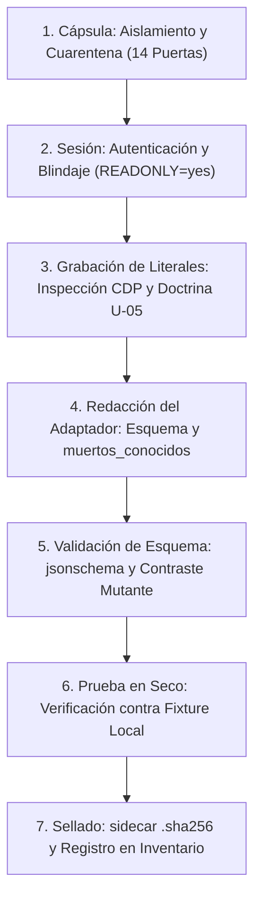

# Guía Canónica de Alta de Superficies Aisladas

## 1. Alcance y Principio de Desacoplamiento

El presente documento establece el procedimiento canónico para dar de alta una nueva superficie web dentro de la arquitectura de `opensuperficies-v1`.

### 1.1 Invariante de Desacoplamiento Arquitectónico (Ley L3)
La arquitectura de superficies aisladas se rige por una regla estricta:
- **La web es DATO; el motor es INVARIANTE (DEC-5)**.
- El procedimiento de alta de una nueva plataforma web se realiza **sin abrir, leer, citar por línea ni editar** ningún componente del motor de ejecución (`motor/`) ni de los scripts de orquestación (`scripts/`).
- El contrato de interfaz reside exclusivamente en el esquema `contrato/contrato-superficie.schema.json` y en la taxonomía canónica de códigos de salida tabulada en `guias/GUIA-OPERACION-SUPERFICIES.md`. Si un operador o integrador necesitase alterar el motor o inspeccionar su código fuente para dar de alta una superficie, el desacoplamiento se considera formalmente fallido y el procedimiento debe escalarse.

---

## 2. Los Siete Pasos Canónicos de Alta

El proceso de incorporación de una superficie se compone de siete pasos estrictamente secuenciales:



### Paso 1: Cápsula (Aislamiento y Cuarentena)
Toda interacción previa con el DOM de la superficie debe ejecutarse dentro de un entorno confinado:
1. **Despliegue del Contenedor**: Se inicializa la instancia aislada con display Xvfb interno y servidor gráfico Xpra desacoplado del host.
2. **Verificación de Cuarentena (G-QUARANTINE-14)**: Antes de abrir cualquier página web o inspeccionar selectores, se ejecuta la verificación de las 14 puertas de cuarentena (A..N) descritas en `guias/GUIA-OPERACION-SUPERFICIES.md`.
   - 11 puertas de veredicto (A, E..N) deben resultar en `[PASS]`.
   - La Puerta A verifica que el display `:1` del operador sea inaccesible desde el contenedor (`DISPLAY=:1 xdpyinfo` devuelve fallo, `/tmp/.X11-unix` vacío y cero montajes compartidos).
   - 3 puertas informativas (B, C, D) monitorizan la ausencia de interferencia en el display del operador.
3. **Regla de Parada**: Si la cápsula no pasa la cuarentena, se destruye de inmediato. Jamás se inspecciona un sitio externo sin cuarentena verificada.

### Paso 2: Sesión (Políticas de Autenticación y Blindaje)
1. **Determinación de Necesidad de Sesión**:
   - *Superficies Anónimas*: Si el servicio permite consultas completas sin autenticación, no se crea perfil de usuario.
   - *Superficies Autenticadas*: Si la plataforma exige cuenta de usuario para interactuar, adjuntar archivos o cosechar texto sin restricciones, se requiere sesión interactiva.
2. **Intervención Humana Controlada**:
   - El operador abre el visor visual en el puerto loopback local (`intervenir`).
   - El operador realiza el proceso de inicio de sesión de forma interactiva (credenciales manuales o 2FA).
   - Una vez autenticada la sesión y verificada la llegada a la vista principal, el operador cierra la exposición visual (`blindar`).
3. **Preservación y Blindaje de Perfil**:
   - El perfil de usuario almacenado en disco queda inmediatamente marcado para consumo en modo solo lectura (`READONLY=yes`) durante las operaciones automatizadas.
   - Esto evita la degradación de cookies, la mutación accidental de estados o la corrupción del almacenamiento de Chromium por cierres no limpios.

### Paso 3: Grabación de Literales (Inspección y Doctrina CDP)
La recolección de selectores se realiza conectando una sonda de inspección al puerto de depuración CDP (Chrome DevTools Protocol, e.g. `9222`) del Chromium aislado:
1. **Conexión Pasiva**: Mediante WebSocket contra el endpoint `Runtime.evaluate`, se consultan conteos de nodos (`document.querySelectorAll(selector).length`).
2. **Las Cuatro Reglas Doctrinales de Selección (Lecciones de U-05)**:
   - **Regla 1 (Medición vs Invención)**: Un selector con `n=0` MEDIDO es un DATO empírico («aquí no está presente este nodo»). Un selector que nadie sondeó en vivo NO es un dato: es una invención, y está estrictamente prohibido incorporarlo al adaptador.
   - **Regla 2 (Orden y Colisión Funcional)**: El motor ejecuta acciones (como clicks) sobre el **primer candidato de la lista que resuelve**. Un literal de adorno en una lista de interacción no es inocuo: produce una pulsación en el elemento incorrecto.
     * *Caso Real U-05*: En la familia `boton_enviar`, se coló un literal de botón de voz (`button[aria-label="Use voice mode"]`) que resolvía en pantalla. El motor habría abierto el micrófono en lugar de pulsar enviar, comprometiendo la consulta de pago y provocando un error ambiguo (`RC_AMBIGUO`, código 6) que jamás admite reintento (según la tabla de `guias/GUIA-OPERACION-SUPERFICIES.md`).
   - **Regla 3 (Familias Inobservables y no_verificado_en_vivo)**: Aquellas familias que no pueden observarse pasivamente sin consumir cuota o sin provocar un evento transitorio (`detener`, `chip_adjunto`, `desafio`, `boton_enviar` cuando el editor está vacío) **NO se rellenan a ojo**. Deben declararse explícitamente en el arreglo `no_verificado_en_vivo` del adaptador. Su resolución queda formalmente aplazada hasta el primer ciclo operativo con presupuesto de ejecución. Omitir una familia en silencio es el defecto más grave de un alta.
   - **Regla 4 (Simetría de Instrumentos)**: Ambos extremos de cualquier verificación invariante deben medirse con exactamente el mismo instrumento y los mismos parámetros de deduplicación.

### Paso 4: Redacción del Adaptador
El archivo de configuración debe escribirse en formato JSON conforme a la especificación de `contrato/contrato-superficie.schema.json`:
1. **Metadatos y Vigencia**:
   - `schema`: Identificador fijo `"newton-selectors/v1"`.
   - `sitio`: Nombre de dominio o identificador del servicio (e.g., `"perplexity.ai"`).
   - `medido`: Fecha de la toma de datos en formato ISO `YYYY-MM-DD`.
   - `vigencia_dias`: Entero estricto entre 1 y 90 (período máximo de validez antes de requerir reauditoría).
2. **Las Diez Familias**: Se redacta el bloque `literales` con las diez familias tipificadas.
3. **Gates de Decisión**:
   - `G-AUTH`: Expresión lógica de autenticación (e.g., `"login_cta == null"`).
   - `G-HUMAN`: Expresión lógica de ausencia de desafío (e.g., `"desafio == null"`).
   - `G-ATTACH`: Expresión de presencia de carga de archivos (e.g., `"input_fichero != null"`).
   - `G-SUBMIT`: Expresión de disponibilidad de entrada (e.g., `"editor != null"`).
   - `G-COSECHA`: Expresión de presencia de resultados (e.g., `"stream != null || acciones_fin != null"`).
4. **Timeouts y Umbrales**:
   - Parámetros temporales en segundos (`connect_s`, `action_s`, `stream_idle_s`, `attach_s`, `human_s`).
   - Umbrales de caracteres (`min_chars_cosecha`, `editor_max_chars`).
5. **Tabla de Muertos Conocidos (`muertos_conocidos`)**:
   - Mapeo de selectores que ya no están vigentes o que fueron descartados, junto con el motivo documentado.

### Paso 5: Validación contra el Esquema y Contraste Negativo
1. **Validación Formal**: Se valida el adaptador contra el esquema JSON Schema Draft 2020-12:
   ```bash
   python3 -c 'import json, jsonschema; s=json.load(open("contrato/contrato-superficie.schema.json")); a=json.load(open("contrato/adaptador.<sitio>.json")); jsonschema.validate(instance=a, schema=s); print("SCHEMA: OK")'
   ```
2. **Contraste Negativo del Mutante (C-SCHEMA)**:
   - Se genera una copia mutante del adaptador retirando el atributo obligatorio `vigencia_dias`.
   - Se valida el mutante contra el esquema y se asegura que la validación falle inequívocamente reportando la ausencia de `vigencia_dias`.
   ```bash
   python3 -c 'import json, jsonschema; s=json.load(open("contrato/contrato-superficie.schema.json")); m=json.load(open("contrato/adaptador.<sitio>.json")); m.pop("vigencia_dias"); jsonschema.validate(instance=m, schema=s)' 2>&1 | grep -q "vigencia_dias" && echo "CONTRASTE_MUTANTE: OK (rechazado)"
   ```

### Paso 6: Prueba en Seco (Dry Run Local)
1. **Verificación sin Red**: La prueba se ejecuta exclusivamente contra el archivo de fixture local (`fixture/superficie-fixture.html`) o mediante simulación local de la estructura DOM.
2. **Cero Consumo de Cuota**: Está prohibido emitir peticiones a la red externa o al dominio de producción durante la fase de prueba en seco. La prohibición de red aplica estrictamente a la prueba en seco; el alta se cierra con una cosecha real contra la superficie nueva, que es un paso distinto y posterior; y esa cosecha debe ir contra una superficie SIN cuenta ni cuota cuando sea una prueba de aceptación.
3. **Comprobación de Selectores Base**: Se confirma que los selectores definidos en el adaptador resuelvan de forma determinista sobre el DOM de prueba.

### Paso 7: Sellado y Registro de Inventario
1. **Cálculo de Hash**: Se calcula el digest `sha256` del archivo del adaptador.
2. **Generación de Sidecar**: Se genera el archivo `<adaptador>.json.sha256` conteniendo el hash y la ruta relativa al repositorio (conforme a la regla REP-8).
3. **Registro en Inventario**: Se incorpora la entrada correspondiente en `INVENTARIO-ARTEFACTOS.json` con:
   - `ruta`: Ruta relativa del archivo.
   - `sha256`: Digest medido.
   - `estado`: `"CERRADO"`.
   - `unidad_origen`: Identificador de la unidad responsable.
   - `accion_reverso`: Comando de restauración ejecutable sin dependencia de git (e.g., restauración desde evidencia o copia previa).
4. **Cálculo de Fecha de Expiración**: Se anota la fecha límite de validez (`medido` + `vigencia_dias`).

### Enganche del adaptador con el motor

- El motor NO se edita nunca para dar de alta una superficie. Se le dice cual es su adaptador con la variable de entorno `NEWTON_SELECTORS` y cual es su sitio con la bandera `--url` de `consultar`.
- Si `NEWTON_SELECTORS` apunta a un fichero que no existe o no valida, el motor aborta con `RC_SUSTRATO` (3) y nombra la ruta en el error: ese rc es la confirmacion de que la variable se honro [MEASURED 2026-09-12].
- Sin la variable, el motor usa su adaptador por omision. Eso NO es un fallo: es el valor por defecto, y por eso un alta nueva debe pasar SIEMPRE la variable, tambien en las pruebas.
- La forma canonica de una cosecha contra una superficie recien dada de alta es una sola linea con las dos cosas puestas a la vez, la variable delante y la bandera detras.
- Quien necesite EDITAR el motor para dar de alta una superficie debe parar: el desacoplamiento habria fallado y la escalada es una unidad de correccion sobre el motor, nunca un parche en el alta.

---

## 3. Taxonomía Canónica de las Diez Familias de Selectores

El contrato de superficie define exactamente diez familias de literales DOM que cubren el ciclo de interacción de cualquier superficie conversacional o generativa:

| N° | Familia | Semántica Operativa | Tipo de Elemento Esperado | Tratamiento si no es observable en frío |
|---|---|---|---|---|
| 1 | `input_fichero` | Nodo de entrada para subida de adjuntos/documentos. | `input[type="file"]` | Medir en frío si el input reside en el DOM inicial; si no, `no_verificado_en_vivo`. |
| 2 | `chip_adjunto` | Indicador visual de fichero cargado con éxito. | Contenedor con nombre/tamaño de archivo o clase chip. | Declarar en `no_verificado_en_vivo` (requiere adjuntar fichero). |
| 3 | `editor` | Área de texto principal para escribir el prompt. | `textarea`, `div[contenteditable="true"]`, `[role="textbox"]`. | Medir en frío en la página principal tras autenticación. |
| 4 | `boton_enviar` | Control para disparar el envío de la consulta. | `button[type="submit"]`, `button[aria-label*="Submit" i]`. | Si depende de texto en el editor, declarar en `no_verificado_en_vivo`. |
| 5 | `stream` | Contenedor dinámico donde se genera el texto de salida. | Contenedores de texto fluido, clases tipográficas (e.g. `.prose`). | Medir en hilo existente o declarar en `no_verificado_en_vivo`. |
| 6 | `detener` | Botón para cancelar la generación en curso. | `button[aria-label*="Stop" i]`, botón con icono de stop. | Declarar estrictamente en `no_verificado_en_vivo` (solo existe durante stream). |
| 7 | `acciones_fin` | Bloque de controles que emerge al finalizar la respuesta. | Botones de copiar (`Copy`), compartir (`Share`) o feedback. | Medir en frío sobre un hilo previo o declarar en `no_verificado_en_vivo`. |
| 8 | `citas` | Elementos de referencia bibliográfica o enlaces a fuentes. | `a[href*="/search/"]`, clases con patrón `citation`. | Medir en frío sobre un hilo previo con citas renderizadas. |
| 9 | `login_cta` | Elemento indicador de sesión ausente o llamada a login. | Botón "Sign in", "Log in", o icono de usuario anónimo. | Medir en frío antes de iniciar sesión; desaparece tras login. |
| 10 | `desafio` | Contenedor de desafío de seguridad o verificación interactiva. | Marcos iframe de verificación de borde, contenedor de desafío. | Declarar en `no_verificado_en_vivo` (no debe forzarse artificialmente). |

### Regla de las tres medidas para la familia `citas`

- En `citas`, el motor usa el candidato del puesto **0** y solo ese, y de cada elemento enganchado lee su
  enlace. Por tanto en esta familia el ORDEN no es una preferencia: es todo el contrato.
- Un candidato vale para el puesto 0 si cumple TRES medidas, no una: engancha (`n > 0`), todos los enganchados
  exponen enlace (`con_href = n`) y esos enlaces salen del dominio cosechado (`con_href_externo = n`).
- Caso medido 2026-09-12 (U-11, Wikipedia): `.reference` engancha 55 y expone 0 enlaces; `.reference a` engancha 55
  y expone 55, pero todos apuntan a las notas de la propia pagina; `.reference-text a` engancha 70 y expone 70
  enlaces externos. Solo el tercero es una fuente. Las tres medidas se publican en la sonda.
- `con_href_externo` se mide por DOMINIO: el anfitrion del enlace debe ser distinto del de la pagina cosechada.
  Contar «empieza por http» no sirve: en U-11 eso dio 70 de 70 cuando la cuenta real por dominio era 58 de 70, porque
  12 enlaces del texto de la referencia apuntan al propio sitio (editorial, ISBN, DOI, OCLC, ISSN). Un punado de
  enlaces al propio dominio dentro del texto de una referencia es NORMAL y no invalida el candidato; lo que invalida
  es que TODOS apunten adentro.

---

## 4. Estructura y Función de la Tabla `muertos_conocidos`

La tabla `muertos_conocidos` es el registro histórico de trazabilidad técnica del adaptador. Cumple dos propósitos vitales:

### 4.1 Cementerio de Selectores Caducados por Cambio del Proveedor
Cuando una plataforma web actualiza su interfaz y un selector deja de coincidir, el selector antiguo no se elimina silenciosamente del archivo:
- Se traslada como clave a `muertos_conocidos`.
- El valor asociado documenta el motivo del descarte y el nuevo selector que lo reemplaza.
- Esto previene que futuros mantenedores reintroduzcan selectores obsoletos pensando que fueron omitidos por error.

### 4.2 Registro de Literales Retirados por Conflicto Funcional
Si un selector fue propuesto inicialmente pero durante la auditoría o inspección se detecta que pertenece a otro control o induce a error funcional, se registra con su justificación técnica:

```json
  "muertos_conocidos": {
    "[data-testid="login-cta"]": "El DOM actual de Perplexity usa button:has(use[*|href*='user-circle']) en lugar de data-testid",
    "textarea": "El editor principal de Perplexity es un div contenteditable='true' con id ask-input",
    "button[aria-label="Use voice mode"]": "NO es un control de envio: es el boton de modo de voz que Perplexity muestra con el editor vacio. Entro en el adaptador del turno 21 sin medida ninguna (HAL-U05-1). El motor hace click al primer candidato que resuelve, asi que un literal de voz aqui gasta la consulta de pago en abrir un microfono"
  }
```

---

## 5. Lista de Comprobación de Diez Casillas (Checklist de Cierre)

Toda alta de superficie debe verificar satisfactoriamente las siguientes diez casillas antes de ser admitida a auditoría. Cada casilla cuenta con un comando CLI determinista de una sola línea:

| N° | Verificación | Comando CLI de Comprobación |
|---|---|---|
| 1 | Diez familias presentes en el adaptador | `python3 -c 'import json; a=json.load(open("contrato/adaptador.<sitio>.json")); req={"input_fichero","chip_adjunto","editor","boton_enviar","stream","detener","acciones_fin","citas","login_cta","desafio"}; assert req.issubset(set(a["literales"].keys()))'` |
| 2 | Cada familia con al menos un candidato o en `no_verificado_en_vivo` | `python3 -c 'import json; a=json.load(open("contrato/adaptador.<sitio>.json")); nv=set(a.get("no_verificado_en_vivo",[])); assert all(len(c)>0 for f,c in a["literales"].items()) and all(f in a["literales"] for f in nv)'` |
| 3 | Atributos `medido` y `vigencia_dias` válidos | `python3 -c 'import json, re; a=json.load(open("contrato/adaptador.<sitio>.json")); assert re.match(r"^[0-9]{4}-[0-9]{2}-[0-9]{2}$", a["medido"]) and 1 <= a["vigencia_dias"] <= 90'` |
| 4 | Validación contra el esquema en verde | `python3 -c 'import json, jsonschema; s=json.load(open("contrato/contrato-superficie.schema.json")); a=json.load(open("contrato/adaptador.<sitio>.json")); jsonschema.validate(instance=a, schema=s); print("VALID_SCHEMA=OK")'` |
| 5 | Contraste negativo del mutante en rojo | `python3 -c 'import json, jsonschema; s=json.load(open("contrato/contrato-superficie.schema.json")); m=json.load(open("contrato/adaptador.<sitio>.json")); m.pop("vigencia_dias", None); jsonschema.validate(instance=m, schema=s)' 2>&1 | grep -q "vigencia_dias" && echo "MUTANT_REJECTED=OK"` |
| 6 | Sidecar `.sha256` con ruta relativa verificado | `sha256sum -c contrato/adaptador.<sitio>.json.sha256` |
| 7 | Registro en `INVENTARIO-ARTEFACTOS.json` | `python3 -c 'import json; inv=json.load(open("INVENTARIO-ARTEFACTOS.json")); arts=[x["ruta"] for x in inv["artefactos"]]; assert "contrato/adaptador.<sitio>.json" in arts'` |
| 8 | Sintaxis JSON conforme a RFC 8259 | `python3 -c 'import json; json.load(open("contrato/adaptador.<sitio>.json")); print("RFC8259=OK")'` |
| 9 | Coherencia de gates lógicos obligatorios | `python3 -c 'import json; a=json.load(open("contrato/adaptador.<sitio>.json")); req={"G-AUTH","G-HUMAN","G-ATTACH","G-SUBMIT","G-COSECHA"}; assert req.issubset(set(a["gates"].keys()))'` |
| 10 | Tabla de `muertos_conocidos` estructurada | `python3 -c 'import json; a=json.load(open("contrato/adaptador.<sitio>.json")); assert isinstance(a.get("muertos_conocidos"), dict) and len(a["muertos_conocidos"]) > 0'` |

---

## 6. Sección de Cumplimiento Normativo (Compliance y No Evasión)

El marco operativo de `OpenSuperficies` prohíbe de forma terminante cualquier técnica de evasión o adulteración de entorno (Decisión arquitectónica DEC-7):

### 6.1 Tratamiento de Desafíos Interactivos de Seguridad
Cuando una superficie presenta un desafío de verificación humana o reto interactivo en pantalla:
- El motor automatizado se detiene de forma inmediata emitiendo el código de salida **`RC_HUMANO` (código 7)**.
- El proceso queda suspendido y se activa el sellado `needs_human`.
- El operador humano es el único autorizado para interactuar con la pantalla a través del visor visual (`intervenir`), resolver el reto de forma legítima, y restituir la cuarentena (`blindar`).

### 6.2 Prohibición Expresa de Técnicas de Evasión (DEC-7)
En cumplimiento de las políticas de integridad y de la Ley L6, el sistema establece que:
- **Sin scripts de ocultación**: Queda prohibida la inyección de bibliotecas de ocultación sintética (`st*alth`) en las páginas inspeccionadas.
- **Sin manipulación de propiedades de navegador**: Queda prohibido el falseamiento de propiedades de automatización en el entorno (`sp*ofing` de variables como `w*bdriver`).
- **Sin alteración de huellas de hardware**: Queda prohibida la síntesis o adulteración artificial de huellas de renderizado (`f*ngerprint` de WebGL o Canvas).
- **Sin resolución automatizada de retos**: Queda prohibida la incorporación de solucionadores automáticos de retos o pruebas de Turing (`c*ptcha`, `t*rnstile`, o equivalentes).
- **Preferencia Absoluta por la API Oficial**: El acceso a plataformas web mediante automatización de interfaz de usuario es una solución subsidiaria diseñada para entornos donde no existe alternativa programática. La vía formal, plenamente soportada y recomendada para la integración con cualquier proveedor es siempre el uso directo de su API oficial documentada.

---

## 7. Lo que Esta Guía NO Verifica

Para garantizar la honestidad técnica y evitar falsas asunciones de cobertura, se declaran explícitamente los límites de este procedimiento:

1. **Familias Efímeras y Transitorias**:
   - Elementos como el botón de cancelación (`detener`) o la confirmación de archivo fijado (`chip_adjunto`) solo existen en el DOM durante fracciones de tiempo mientras ocurre una generación activa o una subida en tránsito. Esta guía no verifica en frío su comportamiento dinámico.
2. **La Caducidad como Compromiso Administrativo y no como Garantía Física**:
   - El parámetro `vigencia_dias` define un ciclo formal de revisión y mantenimiento preventivo. No constituye una garantía de que el proveedor externo no modifique la estructura de su DOM antes de la fecha límite estipulada.
3. **Renombrados Estructurales Fuera de las Diez Familias (`RISK-2` del PLAN)**:
   - Si un proveedor introduce un nuevo paradigma de interacción o fragmenta una de las etapas en componentes no contemplados por las diez familias estándar, el adaptador no podrá capturar dicha mutación y requerirá una revisión del esquema contractual.

---

## 8. Política de Caducidad y Mantenimiento

1. **Determinación de Vigencia**:
   - Todo adaptador nuevo se emite con un período de vigencia entre 1 y 90 días (`vigencia_dias`). El estándar recomendado para plataformas en desarrollo activo es de **30 días**.
2. **Fecha de Expiración**:
   - Se calcula sumando `vigencia_dias` a la fecha declarada en el campo `medido`.
3. **Re-auditoría Periódica**:
   - Al alcanzarse la fecha límite, la superficie pasa a estado pendiente de revisión. Se programa una nueva ronda de inspección pasiva CDP para constatar si los candidatos activos siguen resolviendo con `n > 0`.
4. **Ciclo de Retiro**:
   - Aquellos selectores cuya cuenta sea `n=0` en dos revisiones consecutivas se trasladan a `muertos_conocidos`, incorporando los selectores de reemplazo correspondientes.
