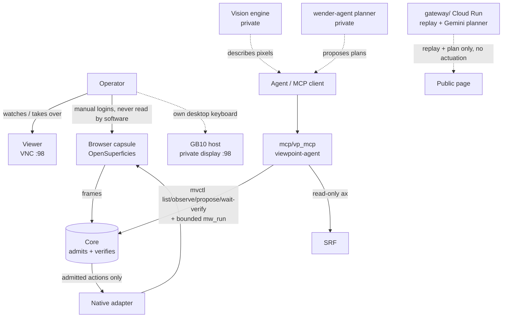
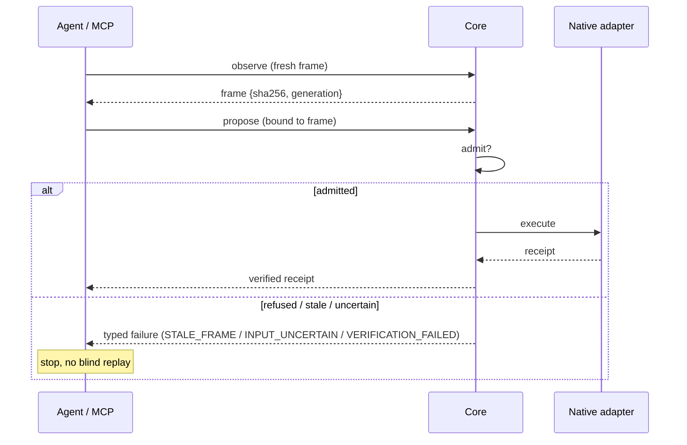

# Architecture

## Component diagram

The gateway is **replay-only**: it serves a recorded session and a Gemini plan. It does not actuate a browser, open a host tunnel, accept credentials, or expose a shell. Native input/capture calls on app-owned capsules bypass core admission and are never used by the MCP server; the only native verb there is read-only `ax`.

## Action loop

Navigation (`vp_navigate`) is three proposals in a row — `Control_L+l`, URL text, `Return` (two when already on a genuine `about:blank`) — each observed fresh and bound to its frame before proposing, each verified before the next step starts.

## Trust boundaries

- **Core admission.** Only the core admits actions and verifies receipts against a fresh frame. The agent proposes; it does not own admission. The vision engine and the wender-agent planner describe pixels and propose plans — neither owns admission.
- **Manual logins, no credential reading.** The operator signs in by hand. Nothing in the stack reads profiles, cookies, or credentials. Gemini login status is AUSENTE; if Google refuses the browser, there is no bypass. No captcha bypass: Reddit is a reCAPTCHA, not bypassed.
- **https-only URLs.** `vp_navigate` accepts only `https://`; `http`, `file:`, and literal private/loopback/link-local hosts are refused before any input. No DNS is resolved in the MCP server, so a DNS name that resolves to a private address is not refused there — the capsule egress policy is the real boundary.
- **Query URLs refused, and why.** A URL with a non-empty query (`?x=...`) is refused immediately — `URL_QUERY_UNOBSERVABLE` — with zero input to the browser. Same for a non-empty fragment (`#x`) — `URL_FRAGMENT_UNOBSERVABLE`. Reason: the capsule AX surface reports `window.url` **without query or fragment by privacy design**, so a query could never verify and a fragment (e.g. a hash route) could never be proven. Verification is therefore document-URL verification (scheme, host, port, path). An empty `?` or `#` is accepted.
- **Typed failures, never success.** `INPUT_UNCERTAIN`, `STALE_FRAME`, and `VERIFICATION_FAILED` stop the sequence. A receipt is the only success.

## Human / agent mode switching

- **Agents** work hidden on the private display (`:98`); the operator watches through the viewer (`view`).
- **Human mode** (per capsule or bulk "Pass all to Humans"): the operator takes over one capsule with a live view; typing reaches the page. Bulk 4/4 views were ready in 51 s [MEASURED].
- **Back to Agents** ("Pass all to Agents"): agents resume control of the capsule.
- **Native desktop window (`show` / `hide`) [TARGET / ON HOLD]** — the first desktop attach took no input and disturbed the operator's session, so it is disabled until it passes on a private test display. The MCP `vp_show` / `vp_hide` tools raise `TAKE_NOT_RUNNING` (or the same hold) unless the take is running and the underlying launcher allows it. Use `view` in the meantime. This is not claimed.
