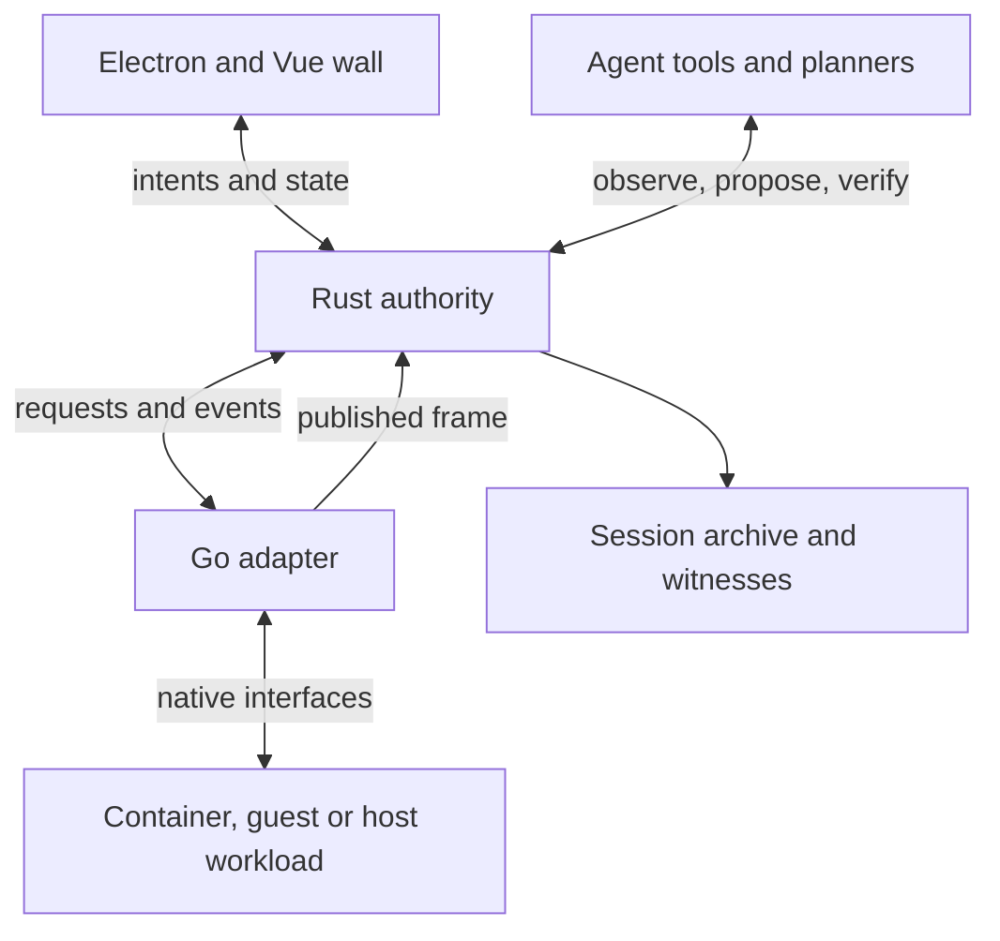
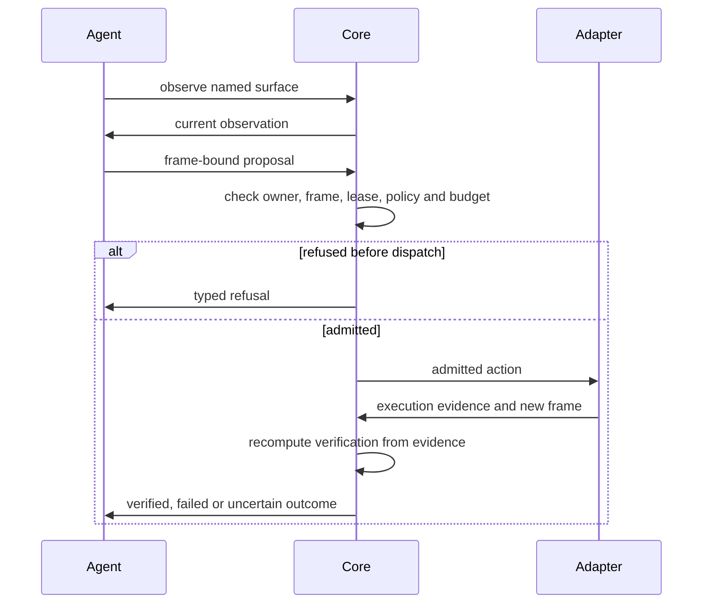

# Architecture

MetaViewer puts explicit admission between an agent's proposed input and its
native executor. The wall displays the resulting state; it does not decide
whether a proposed action is allowed. This document maps the public
implementation. [WHY_CAPSULES.md](WHY_CAPSULES.md) explains the design tradeoffs.
Repeated pins and coordinates are taken from the tree and `deps.lock`; the prose
states the judgment and its limits (FA-0013).

## Context and goals

The architecture separates presentation, authority and execution so that each
agent action has a named target, an admission decision and a recorded outcome.

Answers: why are the wall, core and adapter separate processes?



This diagram maps the core protocol and graphical agent-action loop. Electron
also owns host PTY terminals and role-bound Xpra views; those have distinct
native I/O and cleanup paths. Host terminal execution is not guest-command
execution, and an Xpra role view is not the verified-frame reader. See
[UI architecture](UI_ARCHITECTURE.md), `ui/electron/terminalHost.js` and
`ui/electron/roleHost.js` before changing those paths [CITED: paths just
named].

The split is a protocol boundary, not containment against a compromised process
running as the same host user. A workload's execution boundary depends on its
kind; Host program and Desktop window are not isolated.

Source map: [CITED: `core/src/admission/mod.rs`, `core/src/serve/mod.rs`, `daemon-adapter/internal/daemon/dispatch.go`, `ui/src/catalog/catalogModel.js`].

## Repository and build map

Answers: which programs and trees make up the checkout, and what does each own?

The checkout is a polyglot monorepo with one Cargo workspace member. The core, adapter, UI, agent client and imported components keep separate build systems and meet over process interfaces or pin-checked imports; they are not linked into the core binary. [CITED: `Cargo.toml`, `daemon-adapter/go.mod`, `agents/pyproject.toml`, `ui/package.json`]

| Tree | Build unit | Owns |
| --- | --- | --- |
| `core/` | Rust crate `metaviewer-core`; binaries `metaviewer-core` and `mv-replay` | Admission, control, verification, journal, replay and the wire decoder |
| `daemon-adapter/` | Go module `metaviewer/daemon-adapter`; binary `mv-daemon-adapter` | Surface lifecycle, native input, capture publication, record and guest bridges |
| `ui/` | Electron main process plus Vue renderer; `ui/package.json` | Wall presentation, human input and frame display; no authority |
| `agents/` | Python package `metaviewer-agents`; `agents/pyproject.toml` | Agent client, tool validation, MCP and CLI entry points, perception bridges |
| `contracts/` | Versioned JSON Schema sets `v0.1`, `v0.2` and `v0.3` with examples | Wire shapes shared by the processes |
| `tools/`, `scripts/` | Python, Node and shell utilities | Gate, checks, generators, packaging and install |
| `route/`, `router/`, `catalogue/` | Local index data and query tools | Source and document retrieval; router kit; legacy catalogue |
| `components/` | Three imported component trees | Private component snapshots at pinned commits |
| `tests/`, `docs/`, `examples/`, `changes/`, `memoryweb-builtin/` | Supporting trees | Tests, documentation, examples, change fragments and MemoryWeb fixtures |

The Rust workspace declares `core` as its only member, licence `AGPL-3.0-only`, edition 2021, `rust-version = "1.97"` and `overflow-checks = true` for release builds [CITED: `Cargo.toml`]. The crate forbids unsafe code and exposes the authority modules through `core/src/lib.rs`; its only production dependencies are `serde`, `serde_json`, `tokio` and `sha2` [CITED: `core/Cargo.toml`, `core/src/lib.rs`]. The `metaviewer-core` binary reads its configuration from `MV_CORE_CONFIG`, checks the compiled package version against the registration, binds a Unix socket under the runtime directory and serves the session [CITED: `core/src/bin/metaviewer-core.rs`].

The adapter is one Go binary with separate internal packages for custody, capture, transport, native calls and guest bridges; `daemon-adapter/guest-command-broker/` is a standalone Cargo project for the guest-side command broker, not a workspace member [CITED: `daemon-adapter/go.mod`, `daemon-adapter/guest-command-broker/Cargo.toml`]. The UI is Electron main plus a sandboxed Vue renderer, and the agent package declares no third-party runtime dependencies. Their build commands are owned by their own manifests, not by `Cargo.toml`.

## Process and transport model

The Rust server receives versioned messages from registered peers. It binds
messages to a session and sender before changing authority state; the adapter
bridges admitted requests to native operations.

Answers: where do processes connect, and what makes a message admissible?

| Boundary | Public implementation | Responsibility |
| --- | --- | --- |
| UI to core | `ui/electron/coreLauncher.js`, `core/src/serve/mod.rs` | Start/connect to the core and exchange registered messages |
| Agent to core | `agents/metaviewer_agents/tools.py`, `core/src/serve/tools.rs` | Observe, propose and await verification |
| Adapter to core | `daemon-adapter/internal/daemon/environment.go`, `daemon-adapter/internal/ipc/` | Exchange lifecycle, input and frame events |
| Adapter to executor | `daemon-adapter/internal/capsule/manager.go`, `daemon-adapter/internal/cli/` | Validate native target and parse executor replies |

[CITED: paths in the table]. Messages use newline-delimited JSON envelopes.
Transport validation and stateful admission are separate checks: well-formed
JSON does not establish current ownership or frame freshness.

The adapter requires explicit positive transport limits and deadlines and
rejects settings above its fixed ceilings [CITED: `daemon-adapter/internal/ipc/config.go:20`]. Duplicate/non-increasing sender
sequences are handled separately from offline session replay [CITED: `core/src/replay/mod.rs`]. No proposed executor socket is needed to explain the
current adapter route.

## Build and gate flow

Answers: how is the checkout built, and which gate establishes which result?

Cheap checks run before expensive ones. `tools/gate.sh` is the root aggregate: it runs the `manifests`, `laws`, `contracts`, `unit`, `agents`, `js`, `rust`, `go`, `ui`, `ui-smoke` and `perf` legs, and prints `PASS aggregate` only when every selected leg passes. `--leg` selects one leg while iterating; `--self-test` exercises the gate's own fault-injection fixtures [CITED: `tools/gate.sh`].

| Gate level | Command | Scope |
| --- | --- | --- |
| One root leg | `bash tools/gate.sh --leg contracts` | The named check only |
| Root aggregate | `bash tools/gate.sh` | Every root leg for this checkout |
| Gate self-test | `bash tools/gate.sh --self-test` | The gate's negative controls |
| Monorepo aggregate | `python3 tools/vp_gate.py` | Root legs plus every inventoried component suite |
| Monorepo component step | `python3 tools/vp_gate.py --components` | Component suites only |

`tools/vp_gate.py` runs each root leg through `tools/gate.sh`, then checks the imported components from disposable checkouts at the commits in `deps.lock`, not from `components/`. Each step runs in a memory-capped systemd user scope; a component checkout that is dirty or not at its pin fails before its tests run [CITED: `tools/vp_gate.py`].

The Rust leg runs the formatter pinned by the gate, Clippy with warnings denied, and offline locked tests. The Go leg runs vet and race tests on the host, plus vet and compile checks for the other Linux architecture. The UI leg runs an offline npm installation, Node tests, Vue type checking and a production build [CITED: `tools/gate.sh`]. A cross-architecture compile is not a run on that architecture. The `manifests` leg validates release pins and frozen offline resolution; the `laws` leg applies `LAWS.md` and `tools/check_laws.py`; the `contracts` leg checks every schema against its valid and invalid examples [CITED: `tools/gate.sh`, `LAWS.md`].

The GitHub workflows run the same check families on push and pull request and add packaging and release jobs. A local gate pass is evidence for this checkout and environment, not a published release [CITED: `.github/workflows/ci.yml`, `tools/gate.sh`]. This is also why the gate is a set of separate legs: a narrow change can be checked narrowly, and a red or blocked leg stays visible instead of being averaged into a green aggregate.

## Contract-first rule and mapping

Contracts define permitted message shapes; the receiving implementation decides
which operations are available in the current state. This page is not a second
source of truth: where a sentence encodes a contract, the schema and the handler
are the check, so drift is found by comparison rather than memory (SW-0244).

Answers: which messages connect observation, admission and execution?

| Message family | Purpose | Implementation to inspect |
| --- | --- | --- |
| `envelope`, `hello` | Session and peer identity, ordered transport | `core/src/wire/`, `core/src/serve/mod.rs` |
| `surface_request`, `surface_event` | Lifecycle, input and published surface state | `core/src/serve/mod.rs`, `daemon-adapter/internal/daemon/dispatch.go` |
| `frame_ref` | Captured bytes, geometry, digest and generation | `daemon-adapter/internal/frames/publisher.go`, `core/src/journal/mod.rs` |
| `action_proposal`, `action_verdict`, `action_receipt` | Proposed action, admission, execution and verification outcome | `core/src/admission/mod.rs`, `core/src/serve/tools.rs` |
| `ui_intent` | Layout and takeover requests | `core/src/serve/layout.rs`, `core/src/serve/mod.rs` |
| `capsule_state_request` | Stored profile data operations | `daemon-adapter/internal/capsule/slots/store.go` |
| Guest-command and Rewind messages | Guest execution and restore authority | `core/src/serve/guest_command.rs`, `core/src/serve/rewind.rs` |
| `headless_request`, `headless_event` | Authenticated non-graphical lifecycle and retained reservation | `core/src/serve/headless.rs`, `core/src/headless.rs`, `daemon-adapter/internal/daemon/headless_environment.go` |

[CITED: paths in the table; schemas in `contracts/`]. Read the decoder and
handler as well as the schema: schema presence alone does not prove a live
producer, a wired handler or support on the current host. Contribution rules
are in [LAWS.md](../LAWS.md).

## Capture and integration seams

The adapter publishes captured frames; the core validates their evidence before
using them; Electron reads verified bytes for presentation. A frame reference
alone is not proof that its pixels are available or valid.

Answers: how do pixels become evidence, and what depends on private components?

| Stage | Check or boundary | Source |
| --- | --- | --- |
| Native capture | Capture the configured workload and publish immutable frame metadata | `daemon-adapter/internal/frames/publisher.go` |
| Core witness | Validate bytes, digest, geometry and generation for the surface | `core/src/journal/mod.rs`, `core/src/serve/mod.rs` |
| UI delivery | Validate frame input before exposing it to tiles | `ui/electron/frameReader.js` |
| Perception/planning | Cross the configured process interface | `agents/metaviewer_agents/perception/vcore.py`, `agents/metaviewer_agents/wender_bridge.py` |

[CITED: paths in the table]. `wender-agent`, `vision-engine` and
`OpenSuperficies` are separate programs, vendored under `components/` (`AGPL-3.0-only`). Their pins are declared in
`deps.lock` and listed with their seams in
[Vendored components and pins](#vendored-components-and-pins); public code
documents how MetaViewer calls them, not their internal algorithms or
containment implementation. Licensing and judge evaluation rights
are defined by [NOTICE-EVALUATION.md](../NOTICE-EVALUATION.md).

A digest match establishes byte identity. It does not establish that a visual
element has the intended meaning, or that the application stayed unchanged
until input arrived. Retained session witnesses and live shared-memory frames
also have different lifetimes; do not substitute a vanished live frame for the
archive required by replay.

## Vendored components and pins

Answers: which private components are imported, at which commits, and where is the seam?

Three separate programs are imported under `components/`: `vision-engine`, `wender-agent` and `OpenSuperficies`. `deps.lock` records each component's kind, repository, version and full commit; that pin is the provenance identity, and a version string printed inside an imported tree does not override it [CITED: `deps.lock`]. A version is a pin, not folklore: a bounded upgrade claim needs the changed commit and evidence that the old and new interfaces agree (KU-0051; ZIG.14).

| Component | Kind and pin | Public seam |
| --- | --- | --- |
| `vision-engine` | `python_package`, `v0.2.2`, commit `e34786e2f61c7d75842eea371f5617beb47c3587` | `vcore` and `vadapt` command-line interface; in source mode the agent perception adapter passes RAM-only frames and reads closed JSON replies |
| `wender-agent` | `python_package`, `v0.3.4`, commit `1db08d156e74eadc8448aeaa71ff661f665a8671` | Pipe-only planner process (`python -m wender.plan.cli`) in source mode, or the verified compiled executable's `plan` entry; JSON request and reply; the planner owns no admission |
| `OpenSuperficies` | `go_binary`, `os-cu-w9-mv1`, commit `3cb86d752f38457b6730eefd235d4da4c4039721` | `srf-*` binaries selected by `MV_SRF_BIN_DIR`; the adapter invokes them through its bounded CLI runner |

The imported trees are source snapshots for reading and gate fixtures; MetaViewer does not link them into the core or adapter. Source checkout selection uses `VQA_VE_ROOT` for `vision-engine` and `MV_WENDER_ROOT` for `wender-agent`; the adapter launches OpenSuperficies from `MV_SRF_BIN_DIR`. Lock enforcement is caller-specific: `VCorePerceptionAdapter` defaults to `verify_lock=False`, while the Wender verification entry explicitly resolves the lock and enables verification. Do not infer pin enforcement from root selection alone; inspect the constructing caller. No private implementation is imported into the pipe-only Wender bridge [CITED: `agents/metaviewer_agents/perception/vcore.py:268`, `agents/metaviewer_agents/verify.py:103`, `agents/metaviewer_agents/perception/deps_lock.py`, `daemon-adapter/internal/daemon/environment.go`].

The Python adapters also support source-free distributions through `MV_VISION_EXECUTABLE` and `MV_WENDER_EXECUTABLE`. `agents/metaviewer_agents/perception/compiled.py` verifies `agents/metaviewer_agents/perception/compiled.lock.json`, its commit against `deps.lock`, and the distribution's files and hashes before returning an executable. This implementation is Linux x64 only. The compiled planner uses the executable's `plan` entry instead of `python -m wender.plan.cli`; an explicitly selected invalid distribution refuses rather than selecting source mode [CITED: `agents/metaviewer_agents/perception/compiled.py:111`, `agents/metaviewer_agents/wender_bridge.py:494`].

The pin in `deps.lock` remains the provenance record for all three, even where the process boundary receives only a directory. The full monorepo gate clones the pinned commits from local Git objects into disposable checkouts; its test working trees are those checkouts, not `components/` [CITED: `tools/vp_gate.py`].

None of the three is an admission authority: `vision-engine` describes pixels, `wender-agent` proposes plans, and `OpenSuperficies` runs surfaces. The core alone admits actions and verifies receipts, and the adapter alone owns native custody. That is the non-overlap rule stated as AX-12 in P01.12 and applied to narrow command surfaces in CLX02.02.

The `vision-engine` snapshot reports package version 1.1.0 while `deps.lock` pins the dependency as `v0.2.0`; the commit is the source identity, and this page does not reconcile the labels. Treat the difference as a provenance question for an upgrade, not as permission to substitute one version for the other [CITED: `components/vision-engine/pyproject.toml`, `deps.lock`].

## See, propose, admit, act, verify

The agent observes a surface, proposes an action tied to that observation, and
waits for the core's admission and verified outcome before proceeding.

Answers: what is the control loop, and where can it refuse work?



`CoreState::check` is used for admission and dispatch. It rejects unavailable
ownership, stale digest/generation, pending refresh, conflicting surface or
display leases, and invalid budgets [CITED: `core/src/admission/mod.rs:1307`].
Verification uses evidence from the capture owner rather than merely trusting
an executor success bit [CITED: `core/src/verify/mod.rs:32`, `core/src/serve/tools.rs`]. A successful input receipt is not a semantic task
completion claim.

The provider bridge exposes observe/list/propose/wait-for-verification tools;
the stdio MCP layer delegates to the tool client and does not own admission
[CITED: `agents/metaviewer_agents/mcp_server.py:1`]. Operational entry points
and refusal recovery belong in [AI_OPERATOR_GUIDE.md](AI_OPERATOR_GUIDE.md).

## Fold, unfold, pin and take control

Layout changes affect presentation; takeover changes input authority. Folding
a tile does not itself revoke the agent's ownership.

Answers: how is moving or hiding a tile different from taking control?

The core admits supported placement transitions through its layout handler.
Hidden slots must be shown before placement or folding changes; layout does
not create, stop or rebind terminal sessions [CITED: `core/src/serve/layout.rs:1`, `core/src/serve/layout.rs:29`]. The server routes
fold, unfold, move, tab, float, hide and show to that handler; other layout
operations must not be assumed supported just because a UI control exists
[CITED: `core/src/serve/mod.rs:1791`].

Take control records the authority transition and cancels undispatched work.
Dispatched or unknown work can remain draining: takeover is not an undo. Release
and subsequent admission must respect that state and acquire fresh observation
[CITED: `core/src/admission/mod.rs:1262`, `core/src/serve/mod.rs:1791`]. Role
switching has a separate request/result path and availability checks [CITED: `core/src/serve/role_switch.rs:29`].

## Create and destroy

The adapter validates a requested native target before starting it, and it
retains uncertain custody instead of pretending that a workload has disappeared.

Answers: when does a capsule exist, and when is its identity reusable?

Kind, profile and geometry must match an admitted configuration [CITED: `daemon-adapter/internal/capsule/manager.go:818`]. On agent-mode creation, the
adapter captures and publishes an initial frame. If that capture fails, it
attempts bounded compensating destruction and preserves the committed identity
in the error. Human-mode openings do not require the same agent frame consumer
[CITED: `daemon-adapter/internal/daemon/dispatch.go:73`].

Lost bindings retain profile and capacity because the native process may be
orphaned. A verified stop is needed to release custody; a missing frame or
transport failure is not proof of successful cleanup [CITED: `daemon-adapter/internal/capsule/manager.go:862`]. Stored profile data operations
also check custody and compatibility [CITED: `daemon-adapter/internal/capsule/slots/store.go:274`].

Headless, guest-command and Rewind requests have separate handlers and
authority state. Headless creation checks graphical history as well as current
surfaces; an uncertain send retains its reservation. Guest-command admission
checks unclosed graphical custody and held headless state, and command runs
must respect Rewind state. Rewind restore also checks creator authority and
availability. Inspect these handlers together before changing creation,
release or retry behavior; do not apply the graphical frame loop to every
workload [CITED: `core/src/serve/headless.rs`, `core/src/headless.rs`,
`core/src/serve/guest_command.rs`, `core/src/serve/rewind.rs`]. The detailed
guest paths are in [ARM64 guest commands](ARM64_GUEST_COMMANDS.md) and
[ARM64 MicroVM Rewind](ARM64_MICROVM_REWIND.md).

## Core authority and replay

The core records an ordered state transition before replacing current authority
state. Replay reconstructs those transitions from a complete session archive.

Answers: what does the journal prove, and how does it differ from anti-replay?

`Authority::apply_with_witnesses` computes the next state, appends the transition
and witnesses, then installs that state [CITED: `core/src/admission/mod.rs:1514`]. The journal independently recomputes the
transition and checks sequence, previous-record digest and required witnesses
[CITED: `core/src/journal/mod.rs:3123`]. Frame persistence can use bounded group
commit; do not describe every visible frame as independently synced to disk
[CITED: `core/src/journal/mod.rs:59`].

| Mechanism | Purpose | Source |
| --- | --- | --- |
| Transport anti-replay | Refuse duplicate/non-increasing sender messages | `core/src/replay/mod.rs` |
| Session replay | Validate archive closure and reconstruct recorded state | `core/src/journal/mod.rs:3867` |
| Optional external anchor | Check against a separately supplied protected journal head | `core/src/journal/anchor.rs`, `core/src/bin/mv-replay.rs:28` |

[CITED: paths in the table]. Archive consistency alone is not independent proof
of the archive's origin. Keep the journal, sidecars, genesis and witnesses
together; a copied log line is insufficient.

```bash
mv-replay --journal <session-journal> --witness-root <session-root> --verify-only
```

Without `--verify-only`, the command prints the reconstructed state digest.
Invalid input, duplicate evidence and witness failure produce nonzero exits
[CITED: `core/src/bin/mv-replay.rs:42`]. Replay does not inject input into a live
application. If journal capacity is exhausted, the server closes admission,
initiates ordered stopping and asks for a new session [CITED: `core/src/serve/journal_end.rs:128`].

## Supervisor and process safety

Starting a process and proving its cleanup are distinct operations. The public
supervision modules and launchers must be evaluated at their actual call sites.

Answers: does the presence of a supervisor module prove all processes use it?

No. Inspect `core/src/supervisor/` for its library contract and
`ui/electron/coreLauncher.js` for Electron's core lifecycle. Do not infer
end-to-end containment or complete cleanup from a module name, a terminated
parent or a requested stop. The adapter's retained custody on uncertain native
state is part of this distinction [CITED: `daemon-adapter/internal/capsule/manager.go:862`].

## Security and platforms

Control checks restrict admitted operations; they do not turn host-backed
workloads into isolated guests or make captured content safe to publish.

Answers: which trust and platform boundaries remain outside the core?

| Boundary | Consequence | Evidence |
| --- | --- | --- |
| Host program/window | Input and programs retain host exposure | `ui/src/catalog/catalogModel.js:117` |
| Private executor | Public tests can check the seam, not its internals | `NOTICE-EVALUATION.md` |
| Captured pixels and profile data | Screens, inputs and slots may contain private data | `daemon-adapter/internal/capsule/slots/store.go:274` |
| Guest availability | Supported architecture and protected profile are required | `ui/electron/guestCommandProfile.js:5` |
| Rewind | Guest restore does not retract external effects or authority history | `core/src/rewind_flow.rs` |

[CITED: paths in the table]. A successful cross-build is not live platform
qualification. See [ARM64_CAPSULE_SETUP.md](ARM64_CAPSULE_SETUP.md) for the guest
path and [INSTALL.md](INSTALL.md) for installation prerequisites.

## Testing and CI

Use the repository's tests to check contracts and implementation; use live
receipts to establish behavior of the assembled runtime on a particular host.

Answers: how can a contributor verify an architecture claim?

Read the cited handler and its tests, then run the relevant suite. The root
aggregate entry point is `tools/gate.sh`, and `tools/vp_gate.py` adds the
component suites; exact build prerequisites belong in
[TESTING.md](TESTING.md). A documentation-only change can first run:

```bash
python3 -B -m unittest discover -s tests -p 'test_*doc*'
```

Anchor and coordinate checks detect structural mistakes. They cannot prove that
a sentence follows from the source it cites. Likewise, fake executor tests do
not qualify a private native runtime. Report the command and scope actually
checked, retaining failed or unavailable results.

## Open questions

Live performance and deployment assurance remain bounded by the evidence that
is actually available.

Answers: what does this architecture description leave unproved?

Per-kind startup latency, resident memory, broad platform qualification and
comparative reliability require dedicated receipts: **ABSENT — do not invent**
where none are published. Reported live results remain maintainer reports;
source inspection must not promote them to independent measurements. Private
implementation review is outside the public checkout.

The mandate of this document is limited to the cited public repository and
explicitly attributed reports.
